# 天枢云基 (Tianshu Cloud) · 企业级多租户数字化 PaaS 底座与协同中枢

<p align="center">
  
  
  
  
  
  
  
  
  
  
  
</p>

**天枢云基 (Tianshu Cloud)** 是一套面向大中型企业、集团控股公司及 SaaS 服务商的现代化**云原生企业级多租户数字化 PaaS 底座与业务协同中枢**。

本项目不是单纯的后台管理模板或单一业务系统，而是致力于为 **CRM 客户管理、ERP 进销存、WMS 仓储、MES 制造、OA 智能协同、政企服务、供应链枢纽** 等千行百业的数字化系统，提供开箱即用、权威标准、高内聚低耦合的**平台级公共基础设施与全端协同能力**。

---

## 🌟 核心架构与功能矩阵

```
┌────────────────────────────────────────────────────────────────────────────────────────┐
│                      天枢云基 (Tianshu Cloud) 平台全景架构图                             │
├────────────────────────────────────────────────────────────────────────────────────────┤
│ 【接入控制与全端交互】                                                                  │
│   ├─ PC 端控制台 (Vue 3 + TS + Vite)  : iOS 27 / visionOS 流光毛玻璃拟态界面规范        │
│   ├─ 跨端移动工作台 (uni-app / Vue 3) : 悬浮灵动岛毛玻璃 TabBar · H5 / 微信小程序 / App │
│   ├─ 泛域名与多租户路由网关           : *.tianshu.cloud 子域名抽取 · X-Tenant-Code 注入 │
│   └─ 开放互联中枢                     : Open API 网关 (AppKey/HMAC) · SAML 2.0 / OIDC  │
├────────────────────────────────────────────────────────────────────────────────────────┤
│ 【业务中台套件】                                                                        │
│   ├─ 流程审批中心 (Flowable 7.x)      : BPMN 2.0 工业级流程引擎 · 串并行会签 · 驳回转办 │
│   ├─ 客户中心 (CRM)                   : 线索跟进 · 商机漏斗 · 客户公海 · 合同回款       │
│   ├─ 进销存 (ERP)                     : 商品物料 · 采购订单 · 出入库流水 · 动态库存预警 │
│   ├─ 统一支付结算 (Pay Center)        : 微信/支付宝网关 · 聚合收银 · 账单交易流水       │
│   └─ 可视化决策驾驶舱                 : 企业数据大屏 · 报表打印中心 · 审计合规大屏      │
├────────────────────────────────────────────────────────────────────────────────────────┤
│ 【核心中台能力】                                                                        │
│   ├─ 多租户核心 (Multi-Tenant)        : 共享库表行级强隔离 (MyBatis-Plus) · 多物理库扩展│
│   │                                   : 租户独立门户入口识别 · 空间配额 · 套餐生命周期  │
│   ├─ 组织与身份 (Enterprise IAM)      : 集团-企业-部门-岗位-员工 五级架构 · RBAC三位一体│
│   │                                   : 行级数据范围 (Data Scope) · 权限毫秒级透视诊断器│
│   ├─ 分布式高可用调度 (Scheduler)     : Quartz 集群 · 执行管线监控 · 毫秒级熔断告警     │
│   ├─ 分布式文件资产中心 (File Center) : MinIO / 阿里云 OSS / 腾讯 COS / 华为 OBS / S3   │
│   │                                   : 断点续传 · 分片秒传 · 生命周期归档 · 审计销毁   │
│   ├─ 低代码代码生成 (Codegen)         : MySQL 表结构逆向 · 前后端一体化模版 · 质量门禁  │
│   └─ 消息中枢与事件总线 (Integration) : 短信邮件企微网关 · 连接池探针 · Webhook 死信补偿│
├────────────────────────────────────────────────────────────────────────────────────────┤
│ 【系统底座与高可用支撑】                                                                │
│   ├─ 服务编排与发布中台 (DevOps Center): 进程树/Docker双模纳管 · 本地CI构建 · 制品回滚   │
│   │                                   : SSE 实时流式终端 · 智能滚屏吸底 · 端口冲突探针  │
│   ├─ 安全治理与会话强退               : 全局 Access/Refresh Token · 多端在线强退 · 脱敏 │
│   ├─ 数据库版本自动化演进             : Flyway 10.x 增量迁移规范 (V1 ~ V62 持续受控)    │
│   └─ 基础设施运行时监控               : Actuator 探活 · 慢 SQL 智能诊断 · Redis 键空间  │
└────────────────────────────────────────────────────────────────────────────────────────┘
```

---

## 📸 系统全景实机截图 (System Previews)

### 🖥️ PC 端企业级控制台 (iOS 27 / visionOS 流光毛玻璃视觉体系)

| 企业全景大屏与流光毛玻璃驾驶舱 | Flowable BPMN 2.0 流程审批中心 |
| :---: | :---: |
|  | 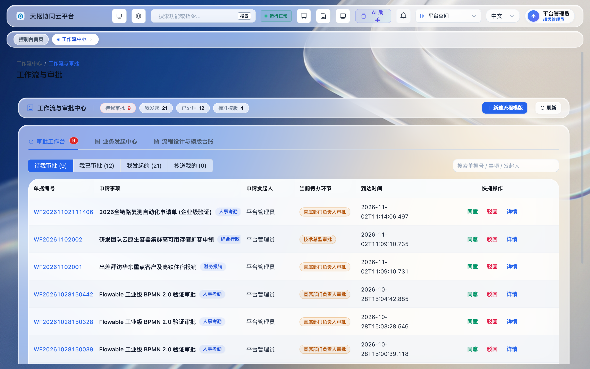 |
| **ERP 进销存与物料仓储中枢** | **CRM 客户全生命周期与商机漏斗** |
| 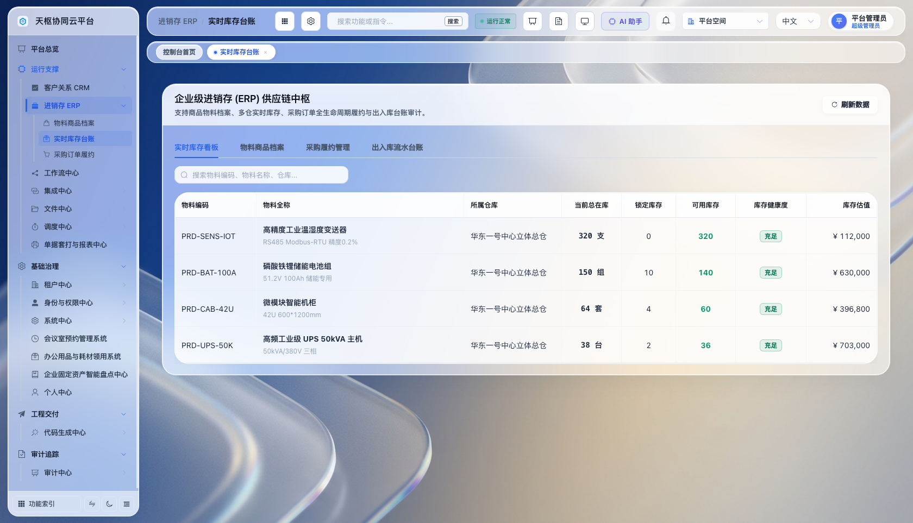 | 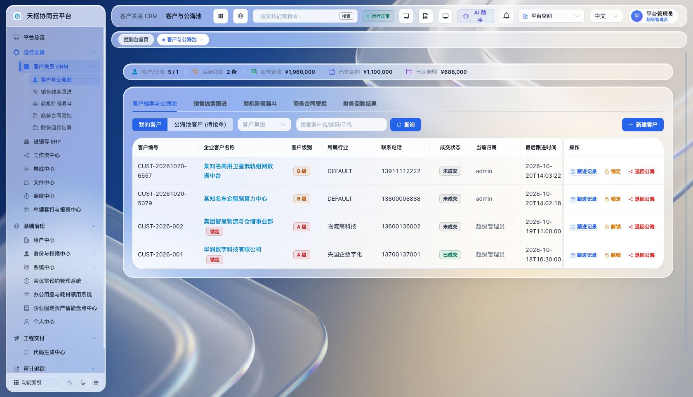 |
| **集团多层级组织架构与权限矩阵** | **服务编排与发布中台 (DevOps Console)** |
| 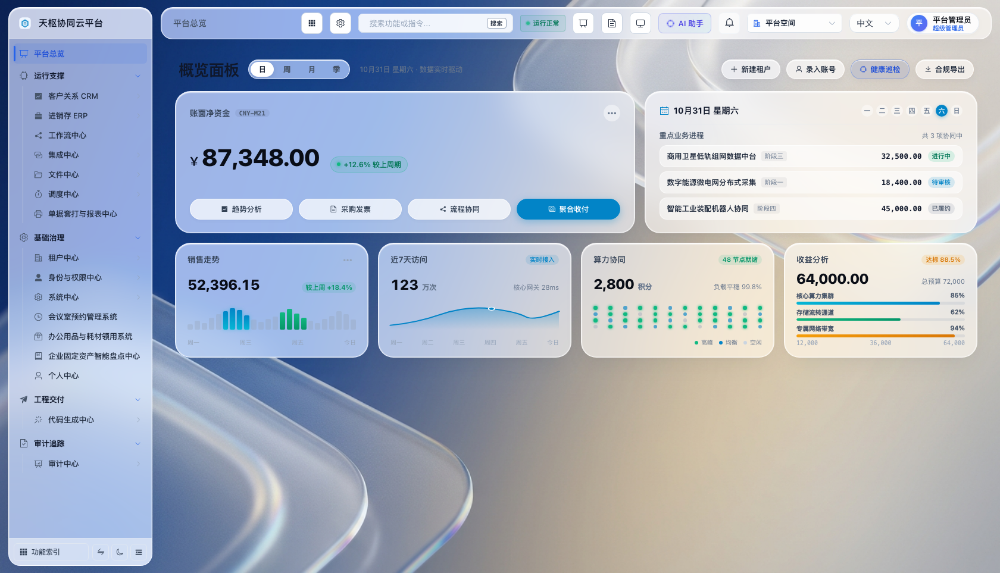 | 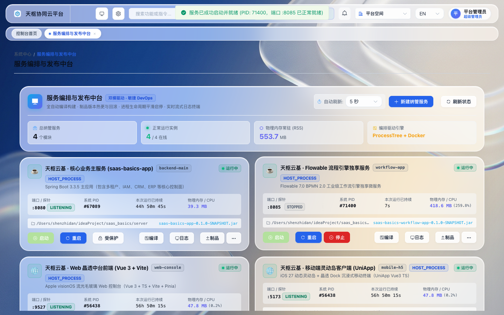 |
| **多租户动态 URL 空间隔离认证** | |
| 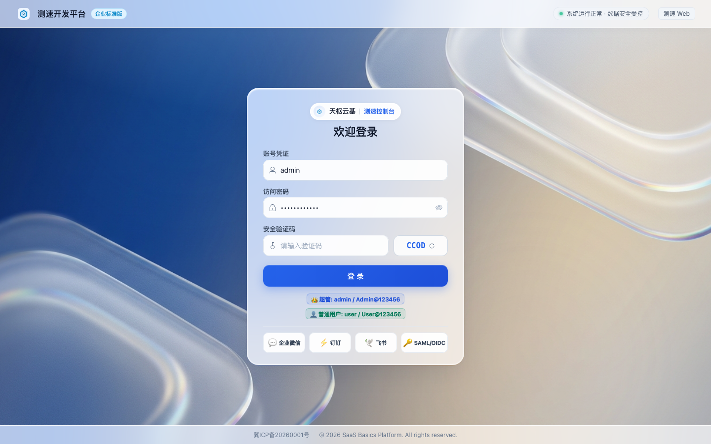 | |

<br/>

### 📱 跨端移动工作台 (uni-app · 悬浮灵动岛毛玻璃 TabBar)

| 移动工作台与悬浮灵动岛 | Flowable 移动审批中心 | 移动 CRM 客户公海 |
| :---: | :---: | :---: |
| 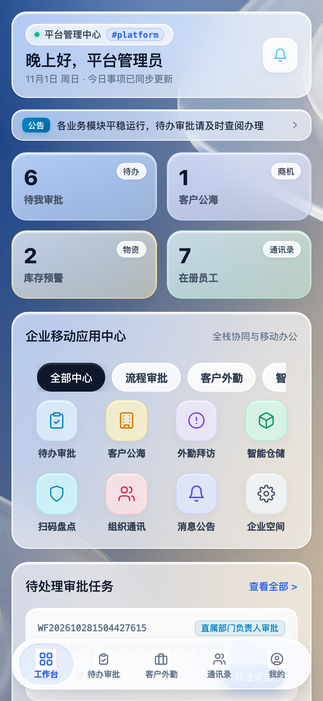 | 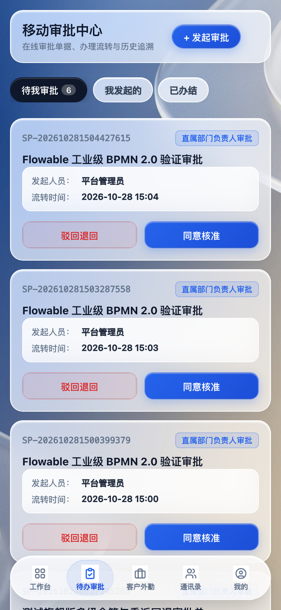 | 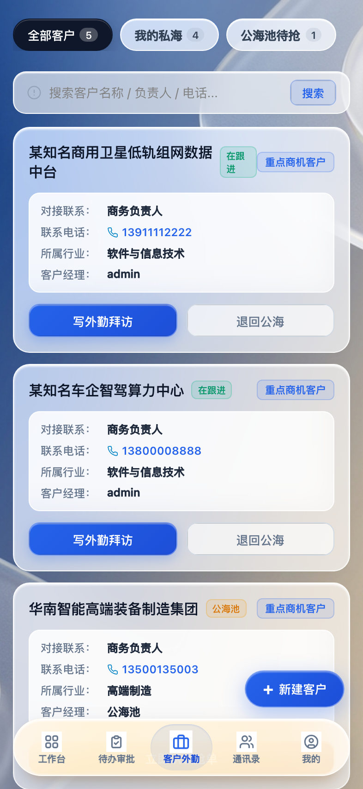 |
| **移动 ERP 云仓库存** | **专属空间数据隔离中心** | **移动端多租户独立登录** |
| 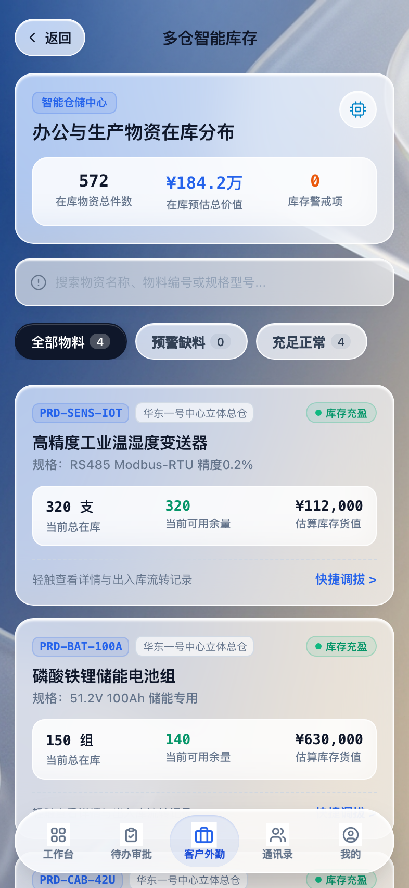 | 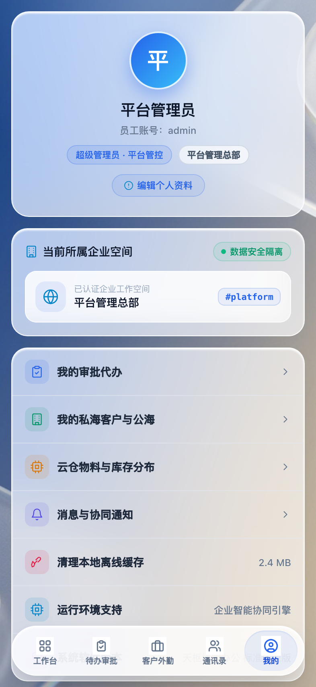 | 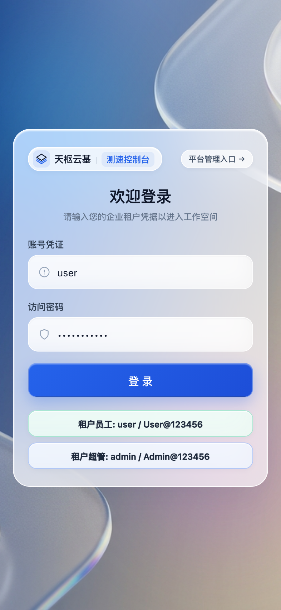 |


---

## 💎 核心技术特色与深度能力

### 1. 🏢 多租户体系与动态 URL 空间隔离 (Multi-Tenancy & URL Routing)
- **权威数据隔离方案**：原生支持字段级共享隔离（`tenant_id`）、独立 Schema、独立数据库以及混合隔离模式，框架底层基于 MyBatis-Plus `TenantLineInnerInterceptor` 深度拦截，研发人员编写业务 SQL 时无需手工关心租户隔离，杜绝跨租户越权漏洞。
- **动静解耦的 URL 路由体系**：
  - **泛域名企业专属门户**：支持 `https://tenant-a.tianshu.cloud` 与 `https://admin.tianshu.cloud`，Nginx 自动提取子域名注入 `X-Tenant-Code` 头；
  - **统一域名路径路由**：支持 `https://console.tianshu.cloud/:tenantCode/`，前端路由守卫通过 `/api/portal/entry` 动态拉取企业空间定制 Logo、背景图与品牌名；
  - **移动端租户空间直连**：移动端 H5 及小程序支持自动通过 URL 参数（`?tenantCode=xxx`）完成租户环境绑定与独立登录，杜绝租户信息混乱。

### 2. 🌊 iOS 27 / visionOS 流光毛玻璃设计规范 (Liquid Glassmorphism)
- **PC 控制台顶级工业设计**：突破传统管理后台沉闷的扁平化色块，全面落地苹果最新的 Liquid Glass 设计语言。涵盖超通透毛玻璃侧边导航栏、多阶高斯模糊滤镜（`backdrop-filter: blur(28px)`）、动态微光漫反射描边（`rgba(255,255,255,0.45)`）、柔和悬浮投影与极光呼吸动态壁纸。
- **移动端悬浮灵动岛 TabBar**：移动端放弃传统生硬贴底的 TabBar，采用悬浮胶囊灵动岛设计，支持平滑缩放动效（Scale 1.15）、呼吸光晕指示器与全端安全区完美避让。

### 3. ⚙️ Flowable BPMN 2.0 工业级流程引擎 (Workflow Engine)
- **工业级流程编排**：由自研轻量状态机全面升级为业界标准的 **Flowable 7.x 流程引擎**（Flyway V57 自动化集成），支持标准 BPMN 2.0 XML 规范。
- **高级审批业务语义**：开箱支持发起审批、待办追踪、串并行会签、驳回上一步、退回发起人、节点加签协办与委托转办。
- **流程状态可视化与全生命周期审计**：提供直观的流程流转拓扑图、节点耗时统计、办理人留痕与审批历史追踪。

### 4. 📱 uni-app 跨端移动工作台 (Mobile Multi-Platform)
- **全端同构技术栈**：位于 `/mobile` 目录，基于 Vue 3 + TypeScript + Pinia + uni-app 4.29 构建。
- **一次开发，多端发布**：完美支持一键构建为 **H5 移动端 Web 应用**、**微信小程序** 以及 **iOS / Android 原生 App**。
- **移动业务全覆盖**：移动端内嵌 Flowable 移动审批中心、CRM 移动商机跟进、ERP 移动库存盘点、员工通讯录与专属个人空间。

### 5. 🛡️ 身份与权限中心 (Enterprise IAM & Data Scope)
- **多企业/集团化多层级组织架构**：标准支持 `集团 ➔ 企业/子公司 ➔ 部门 ➔ 岗位 ➔ 员工` 五级实体，适配大型多元化企业集团与母子公司管控模式。
- **三位一体权限体系**：
  - **功能菜单权限**：动态路由树、徽标、菜单代码与角色深度绑定。
  - **按钮操作权限**：细粒度前端指令（`v-button-permission`）与后端 API 端点鉴权。
  - **行级数据范围 (Data Scope)**：原生支持“全部数据”、“本集团数据”、“本企业数据”、“本部门及下级部门”、“仅本人数据”以及“自定义部门”规则。
- **权限透视诊断器与模拟器**：支持输入任意人员与操作代码，毫秒级穿透输出命中规则链、决策裁定（PASS/DENY）及底层自动改写的 SQL 条件。

### 6. 💼 业务中台套件：ERP 进销存与 CRM 客户管理
- **进销存中心 (ERP)**：包含商品分类、多规格物料档案、采购入库单据、销售出库单据、动态出入库流水核算以及高低库存智能阈值预警。
- **客户中心 (CRM)**：涵盖全渠道线索采集、商机阶段漏斗推进、客户公海池流转与抢单、合同全流程管理与多期回款流水跟踪。

### 7. 💳 统一支付中心与企业 SSO (Pay & SSO Federation)
- **统一支付收银 (Pay Center)**：支持微信支付、支付宝支付通道配置，提供统一下单、扫码收银、异步回调验签、订单退款与多维度财务对账流水。
- **企业身份联邦 (SSO)**：支持企业微信、飞书、钉钉移动端与 PC 扫码免登，以及标准 SAML 2.0 / OIDC 企业身份联邦协议。

### 8. ⏱️ 分布式调度与文件资产中枢
- **Quartz 分布式高可用调度**：主备高可用选举、任务五步流转管线监控、漏触发检测、超时预警与全平台一键应急熔断。
- **分布式文件资产管理**：统一屏蔽底层的存储差异，支持 Local 本地磁盘、MinIO、阿里云 OSS、腾讯云 COS、华为云 OBS、AWS S3，支持分片秒传、冷热生命周期分层与安全防盗链。

### 9. 🚀 数据库自动化迁移 (Flyway V1 ~ V62)
- **数据库版本强受控**：引入 Flyway 10.x 作为生产数据库迁移的唯一准绳，严禁运维手工执行 DDL。
- **平滑增量升级**：涵盖从基础架构（V1）到组织架构（V25）、工作流（V35）、ERP/CRM（V48-V50）、Flowable BPMN（V57）、统一支付（V58-V59）、企业预置种子（V60）、库存加固（V61）以及服务编排中台（V62）的全量迁移脚本，应用容器启动自动自愈演进。

### 10. 🛠️ 服务编排与发布中台 (DevOps Service Center & Local CI/CD)
- **双模驱动纳管引擎**：深度集成宿主机进程树（ProcessTree）与 Docker 容器编排双模，毫秒级探活状态、内存 RSS、CPU 占用、运行耗时与系统 PID。
- **零抖动防混淆状态机**：引入 `STARTING` 与 `STOPPING` 平滑过渡状态，结合端口释放探测，彻底消除传统运维界面过早提示“已停止/已启动”的体验断层；卡片顶部内联零抖动微米发丝进度条，保持网格 UI 极致丝滑。
- **本地 CI 流水线与制品回滚**：支持多技术栈一键触发源码构建，实时输出编译标准/错误流，自动计算 MD5 指纹并归档至制品库，线上故障一键秒级平滑回滚。
- **实时流式日志终端 (SSE Live Stream)**：仿 macOS 深色拟态控制台，支持 15 秒心跳保活、智能滚屏吸底、回溯翻阅自动暂停、悬浮快速回底、正则过滤与本地日志一键导出。

---

## 📂 项目工程全景目录结构

```text
saas_basics/
├── server/                               # 后端 Spring Boot 模块化微服务与单体工程 (Java 17)
│   ├── saas-basics-common/               # 公共常量、上下文、异常处理、统一响应模型与工具类
│   ├── saas-basics-framework/            # 核心切面、动态多数据源、MyBatis-Plus 多租户拦截器
│   ├── saas-basics-app/                  # 核心业务主服务启动入口 (端口 8080)、Web MVC、安全拦截
│   │   └── src/main/resources/db/migration # Flyway V1 ~ V62 数据库版本化自愈脚本
│   ├── saas-basics-workflow-app/         # Flowable 7.x 流程引擎独立微服务应用 (端口 8085)
│   ├── saas-basics-module-iam/           # 身份认证、组织架构、RBAC 三位一体权限、会话治理
│   ├── saas-basics-module-tenant/        # 多租户管理、数据隔离、独立门户入口与空间配额
│   ├── saas-basics-module-workflow/      # Flowable BPMN 2.0 工业级流程引擎模型与工作流中心
│   ├── saas-basics-module-scheduler/     # Quartz 分布式高可用调度中心与管线监控
│   ├── saas-basics-module-file/          # 分布式文件中心、MinIO / S3 多存储适配
│   ├── saas-basics-module-codegen/       # 低代码逆向代码生成中心
│   ├── saas-basics-module-integration/   # 消息网关、数据源探针、Webhook 与死信补偿
│   ├── saas-basics-module-audit/         # 全链路行为审计、风控识别与黑名单阻断
│   └── saas-basics-module-system/        # 系统配置、数据字典、ERP/CRM 底座、DevOps 服务编排中枢
│       └── devops/                       # 进程树管理、本地 CI 流水线、SSE 终端流、制品仓库
├── web/                                  # 前端 Vue3 + TypeScript PC 端控制台 (端口 9527)
│   ├── src/
│   │   ├── api/                          # 前端 API 模块化请求层 (Axios 封装)
│   │   ├── assets/                       # 视觉资源、iOS 27 动态壁纸、矢量图标
│   │   ├── components/                   # 公共业务组件 (ProTable, SchemaForm, 状态徽标等)
│   │   ├── router/                       # 动态路由守卫、多租户 URL 隔离与鉴权拦截
│   │   ├── stores/                       # Pinia 全局状态管理 (Auth, Tenant, Theme, Tags)
│   │   ├── styles/                       # iOS 27 Liquid Glassmorphism 毛玻璃视觉样式系统
│   │   └── views/                        # 业务中心视图层 (CRM, ERP, IAM, 租户, 流程, 审计, DevOps编排)
│   │       └── devops/AppServiceView.vue # 服务编排与发布中台全屏毛玻璃控制台
│   ├── nginx.conf                        # 生产静态托管与反向代理配置
│   ├── package.json
│   └── vite.config.ts
├── mobile/                               # 移动端跨端工作台 (uni-app / Vue 3 / TS, 端口 5173)
│   ├── src/
│   │   ├── pages/                        # 移动端页面 (工作台、流程审批、CRM、ERP、个人空间)
│   │   ├── components/                   # 移动端悬浮灵动岛 TabBar、毛玻璃卡片组件
│   │   ├── api/                          # 移动端轻量 API 请求封装
│   │   └── stores/                       # Pinia 移动端状态中枢 (用户状态、租户绑定)
│   ├── package.json
│   └── vite.config.ts
├── docs/                                 # 架构白皮书与技术文档中心
│   ├── DEPLOYMENT_AND_ARCHITECTURE_GUIDE.md # 生产部署与系统架构全景指南 (可一键导入语雀)
│   ├── manuals/                          # 13 卷独立知识库实战手册专栏
│   ├── backend-enterprise-architecture.md# 后端架构规范与设计决策
│   └── frontend-vue-architecture.md     # 前端架构规范与组件体系
├── docker-compose.prod.yml               # 生产环境全栈容器化一键编排配置
├── compose.yaml                          # 基础中间件编排文件 (MySQL 8.3 + Redis 7.2)
└── README.md                             # 平台官方工程全景文档
```

---

## 🛠️ 技术栈清单

### 后端技术栈 (Backend)
| 组件 / 框架 | 版本基线 | 说明 |
| :--- | :--- | :--- |
| **Java** | 17 LTS | 开发语言基础 |
| **Spring Boot** | 3.3.5 | 核心微服务 / 单体底座应用框架 |
| **Flowable** | 7.0.x | 工业级 BPMN 2.0 流程引擎 |
| **MyBatis-Plus** | 3.5.7 | ORM 持久层框架，提供多租户拦截与分页扩展 |
| **Dynamic-Datasource**| 4.3.0 | 动态多数据源切换与读写分离 |
| **Quartz** | 2.3.2 | 分布式高可用任务调度引擎 |
| **Redis & Lettuce** | 7.2+ | 分布式会话缓存、字典缓存与分布式锁 |
| **Caffeine** | 3.1.8 | 高性能本地一级缓存，构成二级混合缓存 |
| **Flyway** | 10.x | 数据库版本控制与结构迁移自动化 (V1~V59) |
| **HikariCP** | 5.1.0 | 极致性能数据库连接池 |
| **Spring Security** | 6.x | 企业级细粒度安全与鉴权中心 |

### 前端与移动端技术栈 (Frontend & Mobile)
| 组件 / 框架 | 版本基线 | 说明 |
| :--- | :--- | :--- |
| **Vue** | 3.4+ | 响应式核心框架，采用 `<script setup lang="ts">` 语法 |
| **uni-app** | 4.29+ (Vue 3) | 移动端跨端框架，支持 H5、微信小程序与 App |
| **Vite** | 5.x / 6.x | 极速现代前端构建工具 |
| **TypeScript** | 5.x | 全静态类型支持，消除隐式类型错误 |
| **Element Plus** | 2.8+ | 核心 UI 组件库，定制现代化轻量主题 |
| **UI 视觉体系** | iOS 27 Liquid Glass | 全局流光毛玻璃拟态、悬浮灵动岛交互规范 |
| **Pinia** | 2.2+ | 新一代轻量状态管理容器 |
| **Vue Router** | 4.x | 前端动态路由体系，支持多租户 URL 隔离守卫 |
| **ECharts** | 5.x | 企业级高可定制数据大屏与图表库 |

---

## 🚀 快速启动指南

### 1. 本机开发环境要求
- **JDK 17+**
- **Node.js 20+** 及 **npm 10+**
- **MySQL 8.0+**
- **Redis 6.2+ / 7.x**

### 2. 数据库配置
1. 创建数据库 `saas_basics`，字符集推荐使用 `utf8mb4`，排序规则 `utf8mb4_unicode_ci`。
2. 后端集成 **Flyway** 自动版本迁移，启动时会自动按序扫描并执行 `V1` 至 `V62` 全量脚本，无需手动导入 SQL。

### 3. 后端服务启动 (Backend)
```bash
cd server
mvn clean package -DskipTests

# 1. 启动核心业务主服务 (saas-basics-app, 监听 8080)
java -jar saas-basics-app/target/saas-basics-app-0.1.0-SNAPSHOT.jar \
  --spring.datasource.url="jdbc:mysql://127.0.0.1:3306/saas_basics?useUnicode=true&characterEncoding=utf8&serverTimezone=Asia/Shanghai" \
  --spring.datasource.username=root \
  --spring.datasource.password=your_password

# 2. 启动 Flowable 工作流引擎独享服务 (saas-basics-workflow-app, 监听 8085)
java -jar saas-basics-workflow-app/target/saas-basics-workflow-app-0.1.0-SNAPSHOT.jar \
  --spring.datasource.url="jdbc:mysql://127.0.0.1:3306/saas_basics?useUnicode=true&characterEncoding=utf8&serverTimezone=Asia/Shanghai" \
  --spring.datasource.username=root \
  --spring.datasource.password=your_password
```
> 核心业务服务：`http://localhost:8080`  
> 流程引擎服务：`http://localhost:8085`  
> *(亦可直接在 PC 控制台「系统中心」->「服务编排与发布中台」中一键启停与编译)*

### 4. PC 前端控制台启动 (Web Console)
```bash
cd web
npm install
npm run dev
```
> PC 前端访问入口：`http://localhost:9527`

### 5. 跨端移动端启动 (Mobile)
```bash
cd mobile
npm install

# 运行 H5 移动工作台
npm run dev:h5

# 或运行微信小程序编译预览
npm run dev:mp-weixin
```
> 移动端 H5 访问入口：`http://localhost:5173`

### 6. 初始登录凭证矩阵
| 角色定位 | 租户编码 / 所属空间 | 账号 | 默认密码 | 核心特权与应用范围 |
| :--- | :--- | :--- | :--- | :--- |
| **平台超级管理员** | 平台管控总部 (`platform`) | `admin` | `Admin@123456` | 全平台超管控制台，拥有租户入驻、配额套餐、系统运维与全域治理权限 |
| **天枢测速控制台** | 示范企业空间 (`tenant-ce`) | `admin` | `Admin@123456` | 企业专属空间超管，数据完全隔离，包含 ERP/CRM/Flowable 流程业务 |
| **普通业务员工** | 示范企业空间 (`tenant-ce`) | `user` | `User@123456` | 专属空间业务协同人员，包含日常单据报销、移动端外勤与协同工作台 |

---

## 🐳 生产环境容器化编排与部署

本项目原生提供经过严格生产验证的 Docker Compose 编排，支持一键拉起 MySQL、Redis、后端与前端静态托管容器：

```bash
# 1. 克隆代码仓库
git clone git@github.com:SeanCode-super/saas_basic.git
cd saas_basics

# 2. 启动生产编排集群
docker compose -f docker-compose.prod.yml up -d

# 3. 生产部署全流程与 Nginx 泛域名配置
详见文档：docs/DEPLOYMENT_AND_ARCHITECTURE_GUIDE.md
```

---

## 📚 详细设计与 13 卷实战知识库 (Yuque Manuals)

本项目提供完整的现代化架构指南与已模块化的 13 卷实战手册，支持一键导入语雀等知识库：

| 卷号与实战手册 | 文档直达链接 | 核心内容提要 |
| :--- | :--- | :--- |
| **卷 01. 平台定位与系统架构全景** | [`docs/manuals/01_平台定位与系统架构全景.md`](./docs/manuals/01_平台定位与系统架构全景.md) | 集团控股与 SaaS 平台定位、分层全景架构拓扑与核心特性 |
| **卷 02. 核心生产端实机视觉呈现** | [`docs/manuals/02_核心生产端实机视觉呈现_UI_Showcase.md`](./docs/manuals/02_核心生产端实机视觉呈现_UI_Showcase.md) | PC 流光毛玻璃驾驶舱与移动端悬浮灵动岛实机高清图解 |
| **卷 03. Docker Compose 一键生产编排部署** | [`docs/manuals/03_Docker_Compose_一键生产编排部署.md`](./docs/manuals/03_Docker_Compose_一键生产编排部署.md) | 包含生产 compose 文件详解、健康检查、日志轮转与备份 |
| **卷 04. 生产级 Nginx 泛域名网关与 SSL 配置** | [`docs/manuals/04_生产级_Nginx_泛域名网关与_SSL_配置.md`](./docs/manuals/04_生产级_Nginx_泛域名网关与_SSL_配置.md) | 泛域名 SSL 通配符终结、子域名提取注入 `X-Tenant-Code`、跨域防刷 |
| **卷 05. 数据库生命周期与 Flyway 自动化迁移** | [`docs/manuals/05_数据库生命周期与_Flyway_自动化迁移.md`](./docs/manuals/05_数据库生命周期与_Flyway_自动化迁移.md) | Flyway 10.x 迁移准绳、V1~V62 全量核心版本线与防篡改策略 |
| **卷 06. 跨端工作台生产构建 (PC/H5/小程序)** | [`docs/manuals/06_跨端工作台生产构建_PC_H5_微信小程序.md`](./docs/manuals/06_跨端工作台生产构建_PC_H5_微信小程序.md) | Vue 3 PC 控制台与 uni-app 跨端工作台全平台打包与发布规范 |
| **卷 07. 生产安全基线 SecOps 与高可用运维保障**| [`docs/manuals/07_生产安全基线_SecOps_与高可用运维保障.md`](./docs/manuals/07_生产安全基线_SecOps_与高可用运维保障.md) | 凭证隔离、网络安全域、数据库冷备份脚本与异常应急预案 |
| **卷 08. 组织架构与企业级 IAM 权限配置指南** | [`docs/manuals/08_组织架构与企业级_IAM_权限配置指南.md`](./docs/manuals/08_组织架构与企业级_IAM_权限配置指南.md) | 集团-企业-部门-岗位-员工五级实体架构，菜单/按钮/行级数据范围 |
| **卷 09. Flowable BPMN 2.0 工业级工作流实战** | [`docs/manuals/09_Flowable_BPMN_2_0_工业级工作流实战.md`](./docs/manuals/09_Flowable_BPMN_2_0_工业级工作流实战.md) | Flowable 7.x 审批流、串并行会签、驳回加签与移动端快捷签批 |
| **卷 10. CRM 客户全生命周期与商机管理实战** | [`docs/manuals/10_CRM_客户全生命周期与商机管理实战.md`](./docs/manuals/10_CRM_客户全生命周期与商机管理实战.md) | 线索跟进、商机阶段漏斗、客户公海池流转与合同回款流水管理 |
| **卷 11. ERP 进销存与云仓物料管理实战** | [`docs/manuals/11_ERP_进销存与云仓物料管理实战.md`](./docs/manuals/11_ERP_进销存与云仓物料管理实战.md) | 物料多规格档案、采购订单、出入库流水核算与高低库存预警 |
| **卷 12. 开放平台 Open API 与企业 SSO 对接指南** | [`docs/manuals/12_开放平台_Open_API_与企业_SSO_对接指南.md`](./docs/manuals/12_开放平台_Open_API_与企业_SSO_对接指南.md) | Open API 签名网关、AppKey/HMAC 鉴权与 SAML/OIDC/企微免登 |
| **卷 13. 服务编排与发布中台 DevOps 运维实战** | [`docs/manuals/13_服务编排与发布中台_DevOps_CI_CD_运维实战.md`](./docs/manuals/13_服务编排与发布中台_DevOps_CI_CD_运维实战.md) | 双驱动编排引擎、本地 CI 构建流水线、制品秒级回滚与 SSE 流式终端 |

- 📖 **生产部署与系统架构全景白皮书**：[`docs/DEPLOYMENT_AND_ARCHITECTURE_GUIDE.md`](./docs/DEPLOYMENT_AND_ARCHITECTURE_GUIDE.md)
- 📐 **后端企业级微服务架构规范**：[`docs/backend-enterprise-architecture.md`](./docs/backend-enterprise-architecture.md)
- 🎨 **前端 Vue 3 架构与组件规范**：[`docs/frontend-vue-architecture.md`](./docs/frontend-vue-architecture.md)
- 🤝 **项目代码贡献规范**：[`CONTRIBUTING.md`](./CONTRIBUTING.md)

---

## 📄 开源许可证

本项目基于 [Apache License 2.0](LICENSE) 协议发布，商业应用友好，可自由扩展与二次定制开发。
