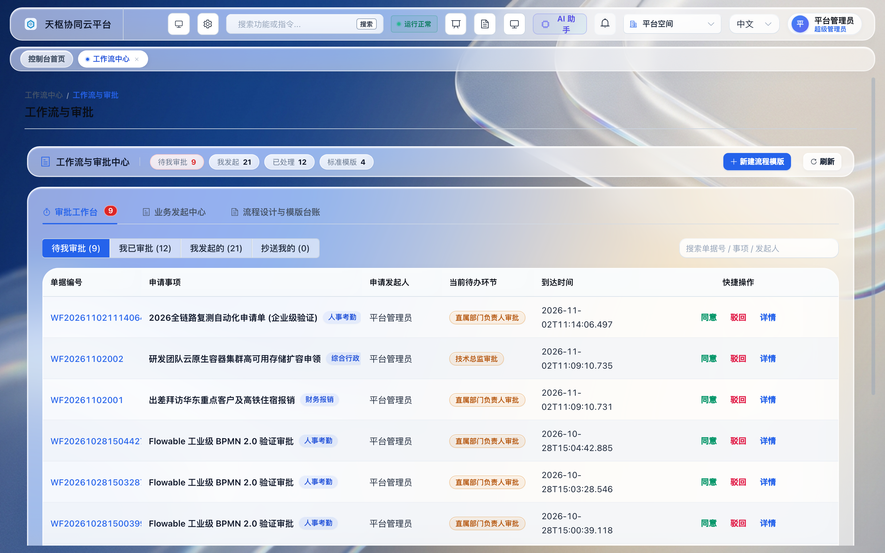
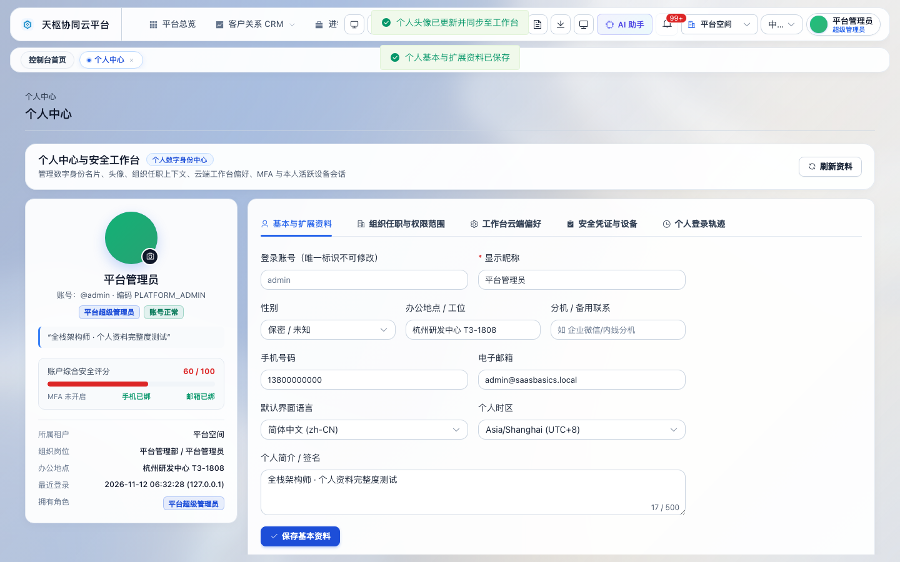
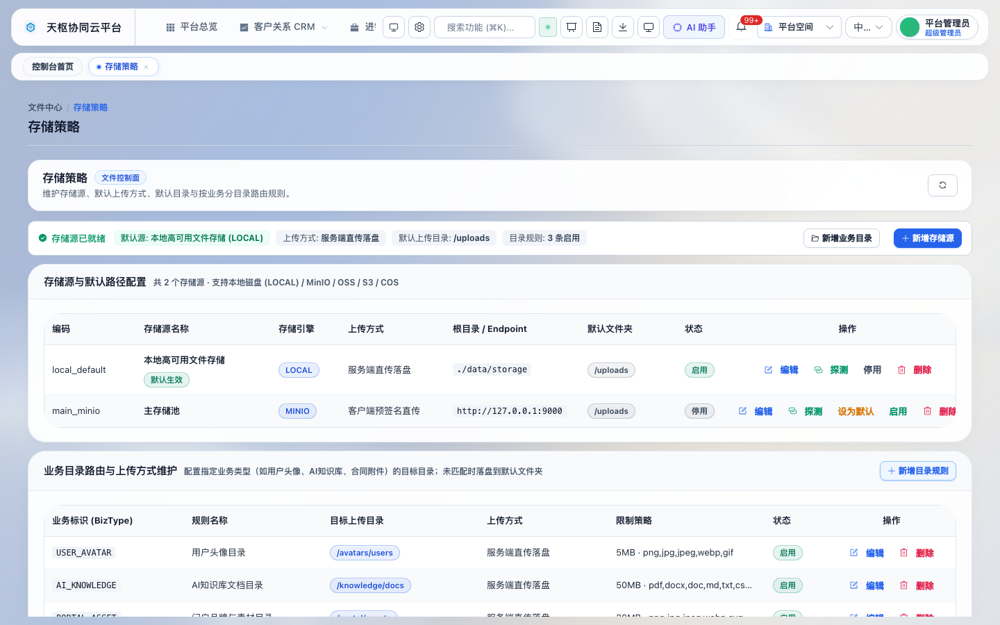
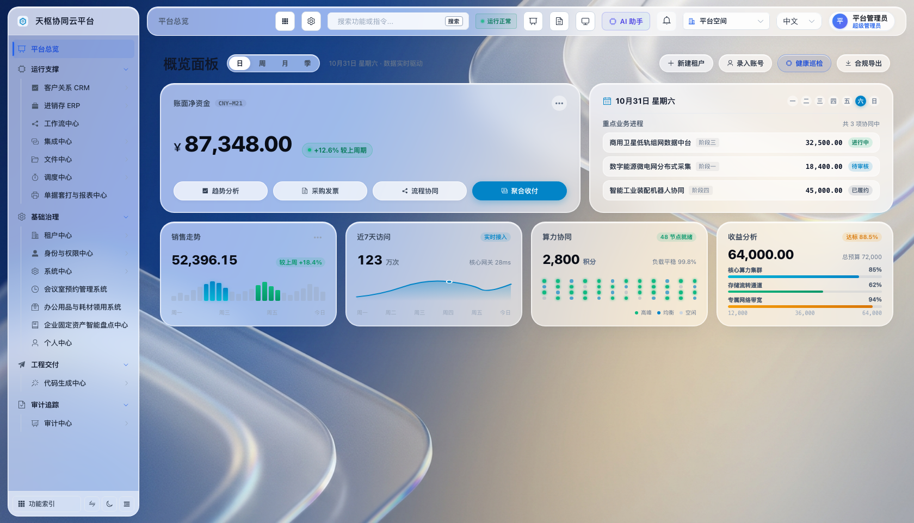
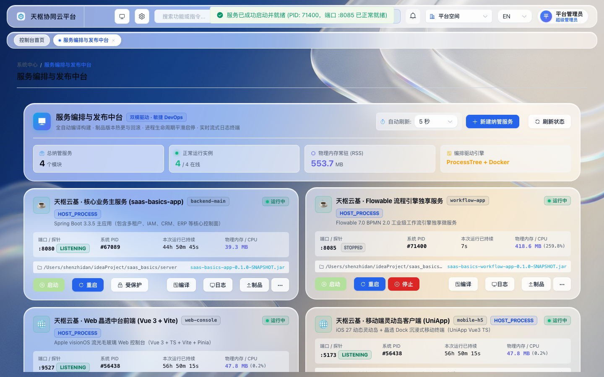

# Tianshu Cloud (`saas_basics`) · AI-Native Multi-Tenant Enterprise SaaS Foundation

<p align="center">
  <a href="./README.md">简体中文</a> | <b>English</b>
</p>

<p align="center">
  <a href="https://github.com/SeanCode-super/saas_basic/actions/workflows/ci.yml"></a>
  <a href="https://github.com/SeanCode-super/saas_basic/releases"></a>
  
  
  
  
  
  
  
</p>

**Tianshu Cloud (`saas_basics`)** is an open-source, industry-neutral, **AI-native multi-tenant SaaS development foundation** built as a clean modular monolith (`Java 17 + Spring Boot 3.3 + Vue 3.5 + TypeScript + uni-app`).

Unlike typical CRUD admin templates, it focuses on strict multi-tenant data isolation, RFC 9562 UUIDv7 organization/identity modeling, controllable end-to-end API payload encryption, native AI Copilot/RAG/Agent capabilities, and cross-platform PC + Mobile workspace parity under the **Apache-2.0** license.

---

## ✨ Key Differentiators

- **🏢 Fail-Closed Multi-Tenancy & Dynamic Routing**: MyBatis-Plus `TenantLineInnerInterceptor` row isolation, wildcard subdomain extraction (`X-Tenant-Code`), tenant quotas, app entitlements, and tenant disaster-recovery snapshot export/restore (`V69`).
- **🔐 End-to-End API Transport Crypto, SCIM 2.0 & Self-Service IAM (`V65`–`V75`)**: Dynamically toggleable (`OFF / OPTIONAL / REQUIRED`) `X25519 + HKDF-SHA256 + AES-256-GCM` payload & query encryption with replay protection, **OIDC PKCE (`RFC 7636`)**, **SCIM 2.0** provisioning (`/scim/v2/*`), self-service OTP password reset & tenant invite links, content-negotiated **RFC 9457 Problem Details**, HMAC Open API replay guard, and `before_json` / `after_json` audit diffs.
- **🤖 AI-Native Core (`saas-basics-module-ai`, `V63`–`V75`)**:
  - Multi-provider AI Model Gateway with **OpenTelemetry GenAI** semantic spans, **bidirectional MCP Streamable HTTP (`2025-03-26`)** Client + Server (`/api/ai/mcp/server`), human approval checkpoints, and Redis Lua per-tenant RPM rate limiting;
  - `⌘K` Command Router & tenant-scoped **NL2SQL Data Copilot** (`AiDataCopilotView`), **Hybrid RAG Knowledge Base** (`KnowledgeBaseView`), **Agent Studio**, and **LoRA Fine-Tune Studio**.
- **🔔 CloudEvents 1.0 Webhooks & Persistent Messaging Ledger (`V75`)**: SSRF-protected outbound webhook subscriptions signed with `X-Webhook-Signature-256` HMAC-SHA256, DLQ replay UI (`IntegrationCallbackSection`), SMTP/SSL mail dispatch & SQL delivery ledger (`int_message_delivery_log`), and deterministic local SVG payment QR rendering.
- **🎨 Spatial 3-Zone Topbar, Dark Mode & Digital Identity (`V74`–`V75`)**: Decluttered Apple Control-Center-style `QuickLaunchpadPopover`, true Light/Dark/System theme synchronization, XSS-safe Markdown AI streaming drawer with Abort support, real dashboard RTT/metering telemetry, and PC/Mobile workspace sync.
- **🗂 AWS SigV4 Object Storage & Per-Business File Routing (`V74`–`V75`)**: Real **AWS Signature Version 4 (`AWS4-HMAC-SHA256`)** S3/MinIO/OSS/COS/OBS signing with presigned PUT/GET URLs, fail-closed upload propagation, per-`bizType` upload mode routing, and explicit missing-storage-source blocking.
- **📤 Global Async Export Queue, Print Center & Flowable BPMN 2.0**: Sync/async exports with watermarks, data masking & scheduled reports (`DownloadCenterView`), VAT/purchase/reimbursement print previews (`PrintCenterView`), and a standalone Flowable 7.x workflow service (`saas-basics-workflow-app`).

---

## 📸 Platform Previews

| Overview Dashboard | Flowable BPMN 2.0 Workflow |
| :---: | :---: |
|  |  |
| **Personal Digital Identity & Workspace (V74)** | **Configurable File Storage & Routing (V74)** |
|  |  |
| **IAM Permissions Matrix** | **DevOps Service & CI Console** |
|  |  |

---

## 🏗️ Repository Layout

```text
saas_basics/
├── server/                            # Spring Boot 3.3 modular monolith + Flowable service (JDK 17)
│   ├── saas-basics-common/            # Shared contracts, exceptions, storage gateway SPI
│   ├── saas-basics-framework/         # Vault crypto, X25519+GCM filter, Lua rate limit, OTel, tenant interceptor
│   ├── saas-basics-app/               # Main API host (:8080) & Flyway migrations (V1 ~ V75)
│   ├── saas-basics-workflow-app/      # Standalone Flowable 7.x BPMN runtime (:8085)
│   └── saas-basics-module-*/          # ai, audit, codegen, dashboard, file, iam, integration, organization, scheduler, system, tenant, workflow
├── web/                               # Vue 3.5 + TypeScript + Vite 6 + Element Plus PC Console (:9527)
├── mobile/                            # uni-app + Vue 3 + TypeScript cross-platform client (:5173, H5 / WeChat MP / App)
├── docs/                              # Architecture whitepaper, Roadmap, ADR, and 15 operational manuals
└── compose.yaml                       # Local MySQL 8.3 + Redis 7.2 stack
```

---

## ⚡ Quick Start

1. **Start MySQL 8.3 & Redis 7.2**
   ```bash
   docker compose up -d
   ```
2. **Start Backend (`server/`, runs Flyway `V1`–`V75` automatically)**
   ```bash
   cd server
   mvn -pl saas-basics-app -am spring-boot:run
   ```
3. **Start PC Console (`web/`)**
   ```bash
   cd web
   npm install && npm run dev
   ```
   Open `http://localhost:9527` (`platform` / `tenant-ce`, demo admin: `admin` / `Admin@123456`).
4. **Run Verification Gates**
   ```bash
   cd server && mvn verify
   cd web && npm run check
   cd mobile && npm test && npm run build:h5
   ```

---

## 🗺️ Roadmap & Known Boundaries

See [`docs/ROADMAP.md`](./docs/ROADMAP.md) and [`docs/M1_ORGANIZATION_IMPLEMENTATION_STATUS.md`](./docs/M1_ORGANIZATION_IMPLEMENTATION_STATUS.md) for current milestone status (`M0` complete, `M1`–`M5` active) and explicit remaining hardening work (such as legacy org backfill cutover, WebAuthn passkeys, Prometheus/Tempo alerting packs, and live GPU fine-tune workers).

## 📄 License

Licensed under the [Apache License 2.0](./LICENSE).
