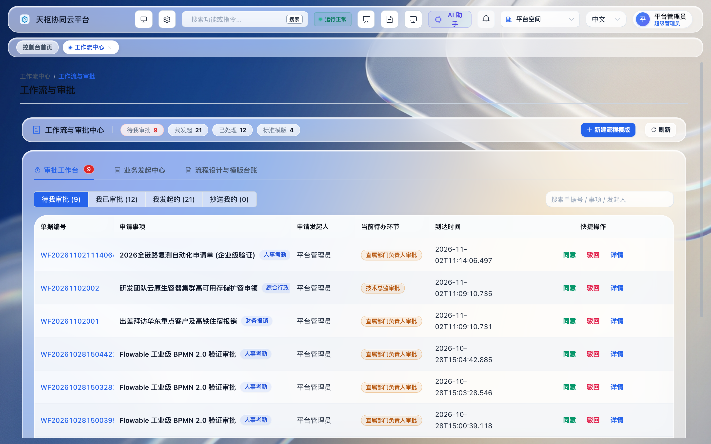
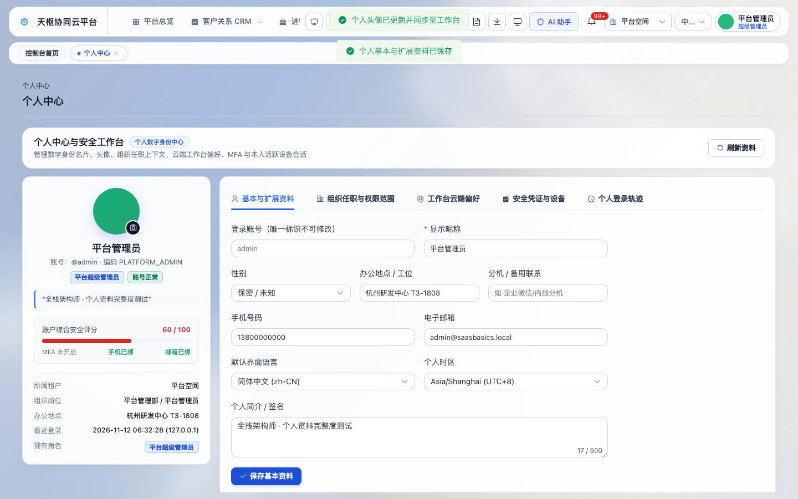
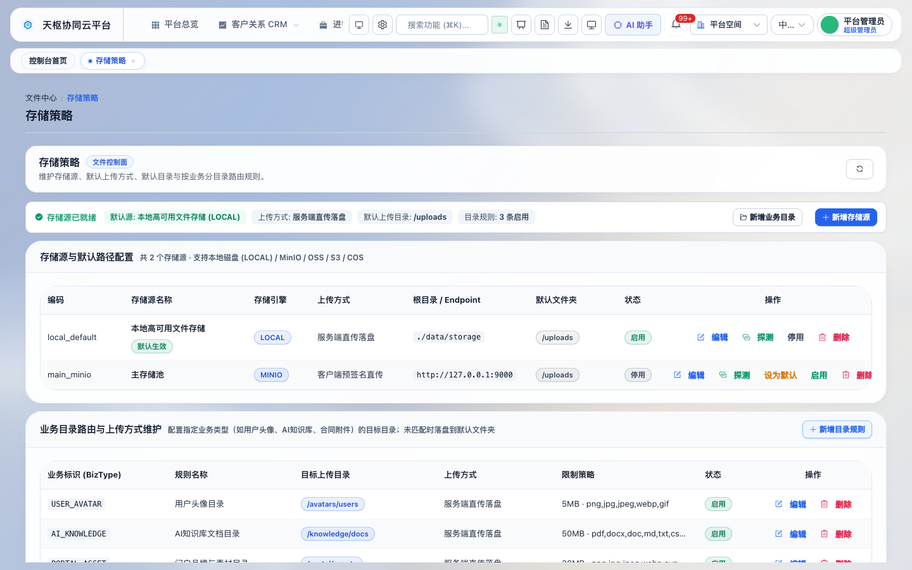
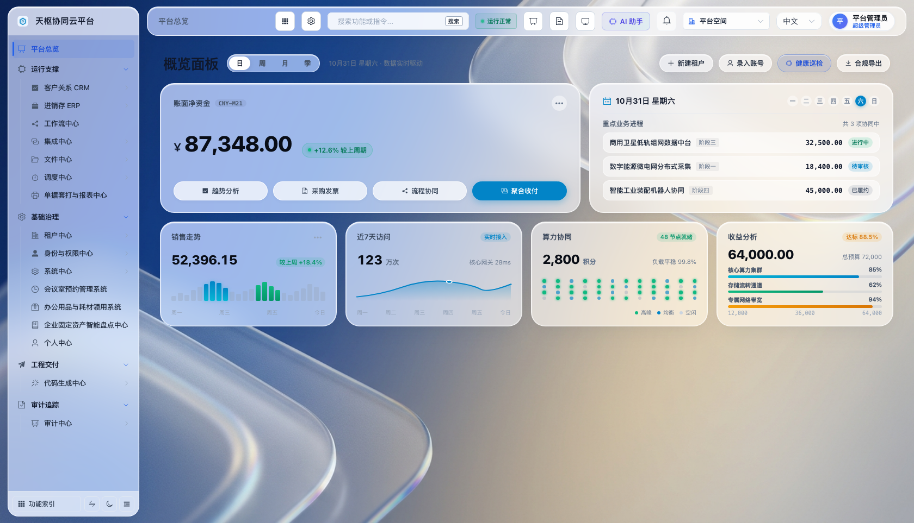
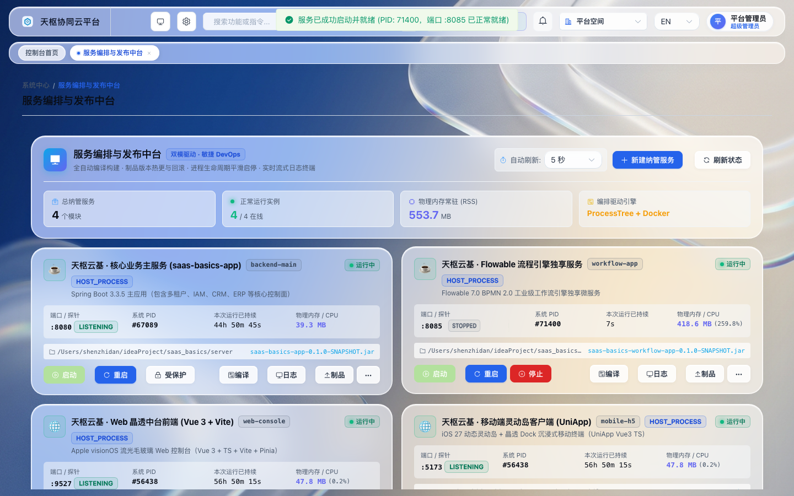

# Tianshu Cloud (`saas_basics`) · AI-Native Multi-Tenant Enterprise SaaS Foundation

<p align="center">
  <a href="./README.md">简体中文</a> | <b>English</b>
</p>

<p align="center">
  <a href="https://github.com/SeanCode-super/saas_basic/actions/workflows/ci.yml"></a>
  <a href="https://github.com/SeanCode-super/saas_basic/releases"></a>
  
  
  
  
  
  
  
</p>

**Tianshu Cloud (`saas_basics`)** is an open-source, industry-neutral, **AI-native multi-tenant SaaS development foundation** built as a clean modular monolith (`Java 17 + Spring Boot 3.3 + Vue 3.5 + TypeScript + uni-app`).

Unlike typical CRUD admin templates, it focuses on strict multi-tenant data isolation, RFC 9562 UUIDv7 organization/identity modeling, controllable end-to-end API payload encryption, native AI Copilot/RAG/Agent capabilities, and cross-platform PC + Mobile workspace parity under the **Apache-2.0** license.

---

## ✨ Key Differentiators

- **🏢 Fail-Closed Multi-Tenancy & Dynamic Routing**: MyBatis-Plus `TenantLineInnerInterceptor` row isolation, wildcard subdomain extraction (`X-Tenant-Code`), tenant quotas, app entitlements, and tenant disaster-recovery snapshot export/restore (`V69`).
- **🔐 End-to-End API Transport Crypto & MFA (`V65`–`V70`)**: Dynamically toggleable (`OFF / OPTIONAL / REQUIRED`) `X25519 + HKDF-SHA256 + AES-256-GCM` payload & query encryption with replay protection and rotatable keyrings, Vault AES-256-GCM credential custody, TOTP MFA, endpoint telemetry/alerting, and `before_json` / `after_json` audit diffs.
- **🤖 AI-Native Core (`saas-basics-module-ai`, `V63`–`V73`)**:
  - Multi-provider AI Model Gateway, MCP server/tool governance with human approval checkpoints, and Redis Lua per-tenant RPM rate limiting;
  - `⌘K` Command Router & tenant-scoped **NL2SQL Data Copilot** (`AiDataCopilotView`);
  - Enterprise **Hybrid RAG Knowledge Base** (`KnowledgeBaseView`) with chunk citations and document compliance review;
  - Visual **Agent Studio** (`AgentStudioView`) & **LoRA Fine-Tune Dataset Studio** (`FinetuneStudioView`, Alpaca / ShareGPT JSONL export).
- **👤 Unified Personal Digital Identity & Workspace Sync (`V74`)**: PC (`ProfileView`) + Mobile (`pages/profile/profile`) parity for avatar upload, multi-assignment organization context switching, self-service active session inspection/revocation, and cloud-synced shell layout/theme preferences (`side` / `top` navigation).
- **🗂 Configurable Per-Business File Routing & Fail-Fast Source Guard (`V74`)**: Decouple storage engines (`LOCAL`, `MinIO` / `OSS` / `COS` / `OBS` / `S3` config) and upload modes (`DIRECT_SERVER` / `PRESIGNED` / `CHUNKED` / `LOCAL_DISK`) per `bizType` (`USER_AVATAR`, `AI_KNOWLEDGE`, etc.), with explicit missing-storage-source blocking before uploads fail.
- **📤 Global Async Export Queue, Print Center & Flowable BPMN 2.0**: Sync/async exports with watermarks, data masking & scheduled reports (`DownloadCenterView`), VAT/purchase/reimbursement print previews (`PrintCenterView`), and a standalone Flowable 7.x workflow service (`saas-basics-workflow-app`).

---

## 📸 Platform Previews

| Overview Dashboard | Flowable BPMN 2.0 Workflow |
| :---: | :---: |
|  |  |
| **Personal Digital Identity & Workspace (V74)** | **Configurable File Storage & Routing (V74)** |
|  |  |
| **IAM Permissions Matrix** | **DevOps Service & CI Console** |
|  |  |

---

## 🏗️ Repository Layout

```text
saas_basics/
├── server/                            # Spring Boot 3.3 modular monolith + Flowable service (JDK 17)
│   ├── saas-basics-common/            # Shared contracts, exceptions, storage gateway SPI
│   ├── saas-basics-framework/         # Vault crypto, X25519+GCM filter, Lua rate limit, OTel, tenant interceptor
│   ├── saas-basics-app/               # Main API host (:8080) & Flyway migrations (V1 ~ V74)
│   ├── saas-basics-workflow-app/      # Standalone Flowable 7.x BPMN runtime (:8085)
│   └── saas-basics-module-*/          # ai, audit, codegen, dashboard, file, iam, integration, organization, scheduler, system, tenant, workflow
├── web/                               # Vue 3.5 + TypeScript + Vite 6 + Element Plus PC Console (:9527)
├── mobile/                            # uni-app + Vue 3 + TypeScript cross-platform client (:5173, H5 / WeChat MP / App)
├── docs/                              # Architecture whitepaper, Roadmap, ADR, and 15 operational manuals
└── compose.yaml                       # Local MySQL 8.3 + Redis 7.2 stack
```

---

## ⚡ Quick Start

1. **Start MySQL 8.3 & Redis 7.2**
   ```bash
   docker compose up -d
   ```
2. **Start Backend (`server/`, runs Flyway `V1`–`V74` automatically)**
   ```bash
   cd server
   mvn -pl saas-basics-app -am spring-boot:run
   ```
3. **Start PC Console (`web/`)**
   ```bash
   cd web
   npm install && npm run dev
   ```
   Open `http://localhost:9527` (`platform` / `tenant-ce`, demo admin: `admin` / `Admin@123456`).
4. **Run Verification Gates**
   ```bash
   cd server && mvn verify
   cd web && npm run check
   cd mobile && npm test && npm run build:h5
   ```

---

## 🗺️ Roadmap & Known Boundaries

See [`docs/ROADMAP.md`](./docs/ROADMAP.md) and [`docs/M1_ORGANIZATION_IMPLEMENTATION_STATUS.md`](./docs/M1_ORGANIZATION_IMPLEMENTATION_STATUS.md) for current milestone status (`M0` complete, `M1`–`M5` active) and explicit remaining hardening work (such as legacy org backfill cutover, AWS SigV4 HTTP PUT signing for external object stores, SMS/Email OTP transport adapters, and live GPU fine-tune workers).

## 📄 License

Licensed under the [Apache License 2.0](./LICENSE).
