# 《天枢云基 PaaS 企业级多租户数字化平台 — 生产部署与系统架构白皮书》

> **文档版本**：v1.0.0 (Release)  
> **面向对象**：系统架构师、DevOps 运维工程师、后端研发工程师、前端全栈工程师  
> **适用环境**：公有云 (阿里云 / 腾讯云 / 华为云 / AWS) / 私有云 Kubernetes / Docker Swarm / 独立 Linux 裸机服务器  

---

## 一、 平台定位与整体架构概览 (System Overview)

### 1.1 平台定位
**天枢云基 (Tianshu Cloud)** 是一套面向大中型企业与 SaaS 服务商的现代化**云原生企业级多租户应用底座**。平台涵盖统一身份认证 (IAM)、细粒度 RBAC 权限引擎、Flowable 工业级工作流引擎、CRM 客户全生命周期管理、ERP 云仓与进销存管理、开放平台 Open API 网关，以及支持 PC 控制台与跨端移动端（H5 / 微信小程序 / 原生 App）的数字化业务协同体系。

```
                         +-----------------------------------------------+
                         |           外部用户 / 终端流量入口            |
                         +-----------------------------------------------+
                                    |                       |
                     HTTPS (泛域名 *.tianshu.cloud)     移动端 / 微信小程序
                                    |                       |
                                    v                       v
                         +-----------------------------------------------+
                         |           Nginx 高可用反向代理网关            |
                         |   - SSL 终结 (Let's Encrypt / 商业通配符)     |
                         |   - 子域名正则提取 -> X-Tenant-Code Header     |
                         |   - 动静分离 (SPA 静态托管 + API 负载均衡)    |
                         |   - Gzip / Brotli 压缩 + 安全防御防刷         |
                         +-----------------------------------------------+
                                    |                       |
                   静态资源与 HTML / 路由兜底               动态后端 API 代理 (/api/)
                                    |                       |
                                    v                       v
          +-----------------------------------+   +------------------------------------+
          |  PC 端 (Vue 3 + TS + Vite 5/6)    |   |  天枢业务主服务 (Spring Boot 3.3.5)|
          |  - 默认端口: 9527                 |   |  - 默认端口: 8080 (saas-basics-app)|
          |  - iOS 27 Liquid Glass UI 视觉    |   |  - Spring Security + JWT 令牌中枢  |
          |  - 多租户 URL 隔离路由体系        |   |  - TenantContextHolder 租户上下文 |
          |  移动端 (uni-app / 灵动岛 TabBar) |   |  - MyBatis-Plus 数据行级租户隔离  |
          |  - 默认端口: 5173 (H5 / 微信小程序) |   +------------------------------------+
          +-----------------------------------+                     |
                                                                    v
                                                  +------------------------------------+
                                                  |  Flowable 流程引擎服务 (独立微服务)|
                                                  |  - 默认端口: 8085                  |
                                                  |  - (saas-basics-workflow-app)      |
                                                  |  - BPMN 2.0 工业级流程引擎独立部署 |
                                                  +------------------------------------+
                                                                    |
                                    +-------------------------------+--------------------+
                                    |                               |                    |
                                    v                               v                    v
                         +--------------------+           +--------------------+   +--------------------+
                         |  MySQL 8.3 数据库  |           |   Redis 7.2 缓存   |   |   MinIO 对象存储   |
                         | - Flyway 自动迁移  |           | - 会话/Refresh 令牌|   | - 附件/合同/媒体   |
                         |   (V1 ~ V62 脚本)  |           | - 分布式锁 / 限流  |   | - S3 协议高可用    |
                         +--------------------+           +--------------------+   +--------------------+
```

### 1.2 核心技术栈规范

| 分层 | 技术选型 | 版本基线 | 核心职责 |
| :--- | :--- | :--- | :--- |
| **应用接入层** | Nginx / OpenResty | 1.27+ Alpine | 泛域名 SSL 解析、动静分离、跨域兜底、子域名提取注入 `X-Tenant-Code` |
| **前端 PC 端** | Vue 3 + TypeScript + Vite | Vue 3.4+ / Vite 5+ | PC 端中后台管理系统，搭载 iOS 27 / visionOS 流光毛玻璃设计语言 |
| **移动端** | uni-app + Vue 3 + Pinia | uni-app 4.29+ | 跨端工作台 (H5、微信小程序、App)，搭载悬浮灵动岛毛玻璃 TabBar |
| **核心后端** | Spring Boot + Java | 3.3.x / JDK 17 LTS | 企业级 SaaS 核心应用，模块化架构与自动装配 |
| **工作流引擎** | Flowable BPMN | 7.x 工业级 | 审批流、转办、驳回、加签、会签与流程拓扑图渲染 |
| **持久层 & 隔离** | MyBatis-Plus + Flyway | MP 3.5.7+ / Flyway 10+ | 行级租户自动拦截器注入 (`tenant_id`)、版本化平滑数据库迁移 |
| **数据与缓存** | MySQL + Redis | 8.3+ / 7.2+ Alpine | 事务 ACID 保障、租户元数据分片、分布式高并发会话控制 |

### 1.3 核心生产端实机视觉呈现 (UI Showcase)

#### PC 控制台视觉体验 (iOS 27 / visionOS 流光毛玻璃)

##### 1. 企业数据大屏与中枢驾驶舱


##### 2. Flowable BPMN 2.0 流程审批中心
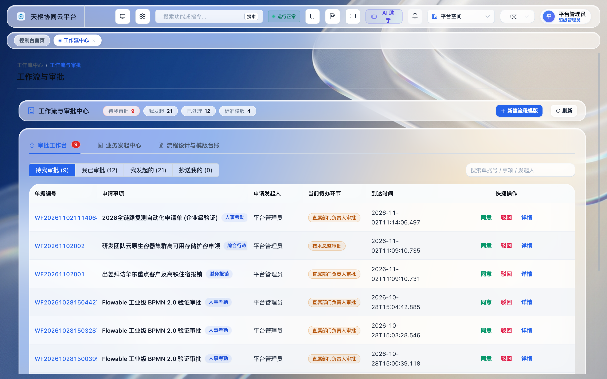

##### 3. ERP 进销存与物料仓储中枢
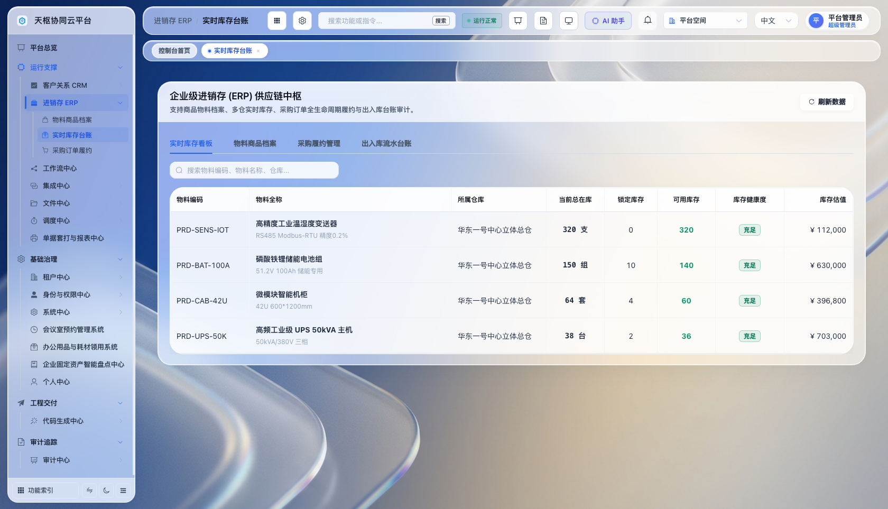

##### 4. CRM 客户全生命周期与商机漏斗
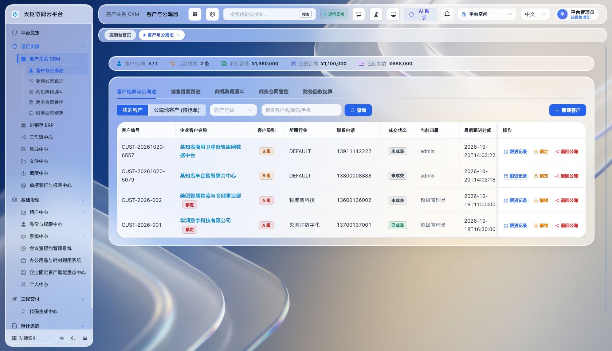

##### 5. 权限矩阵与 IAM 细粒度管控
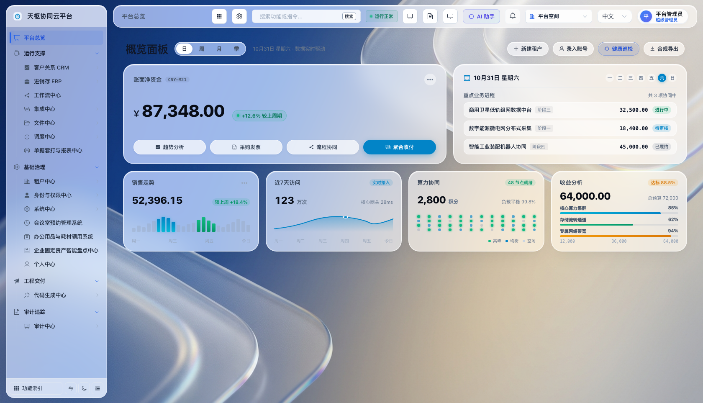

##### 6. 多租户动态 URL 空间隔离认证
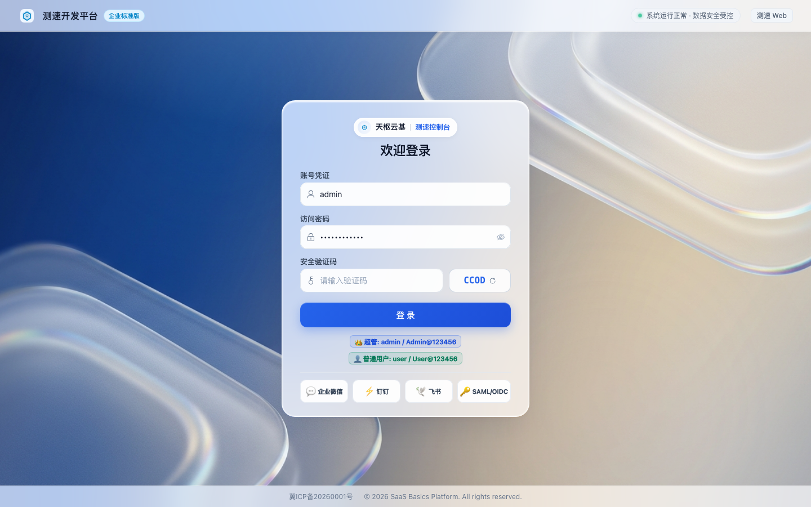

##### 7. 服务编排与发布中台 (DevOps Console)
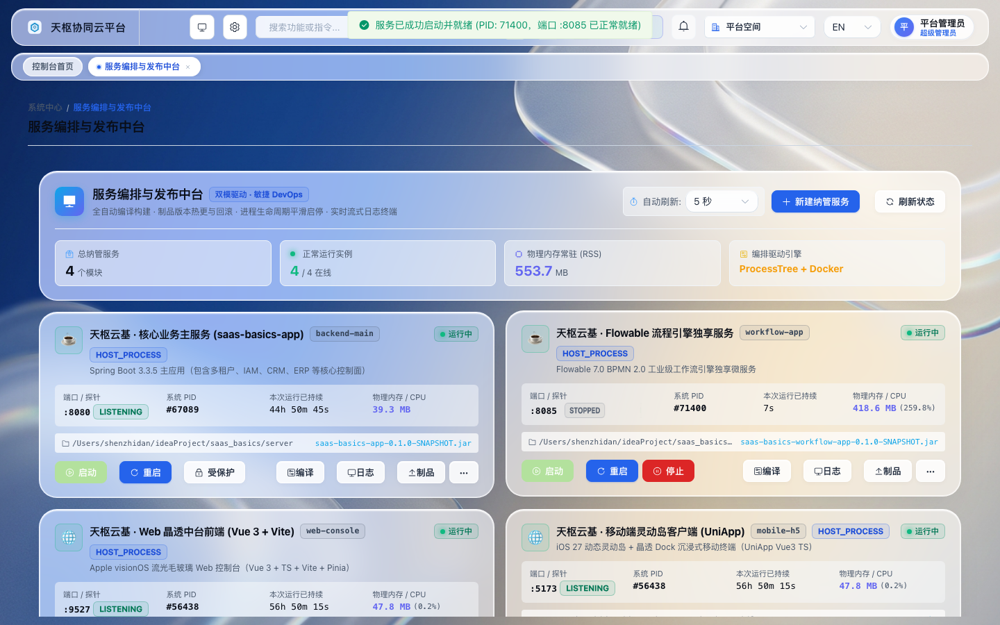

#### 跨端移动工作台视觉体验 (uni-app 悬浮灵动岛 TabBar)

##### 1. 移动工作台与灵动岛导航
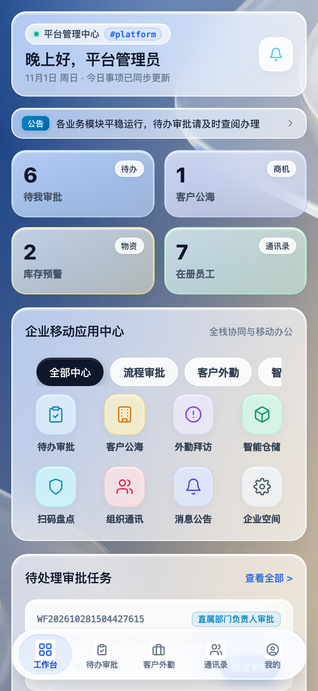

##### 2. Flowable 移动审批待办
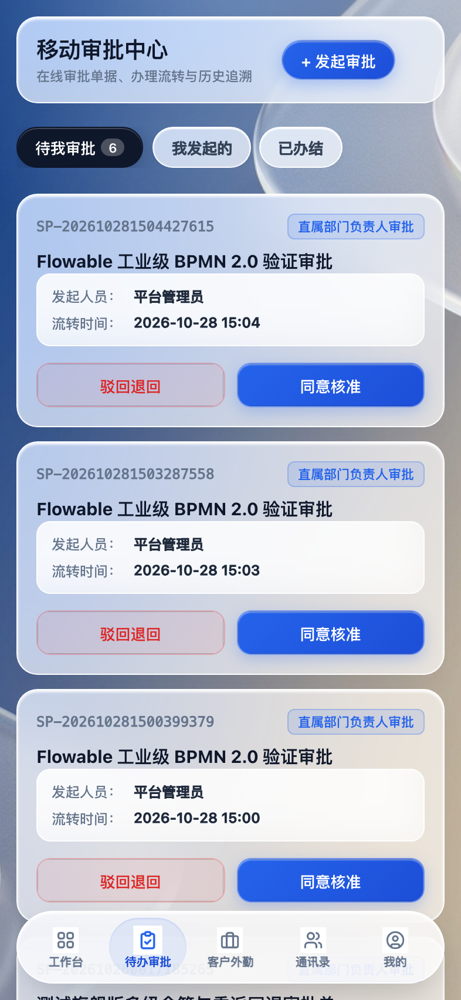

##### 3. 移动 CRM 客户公海池
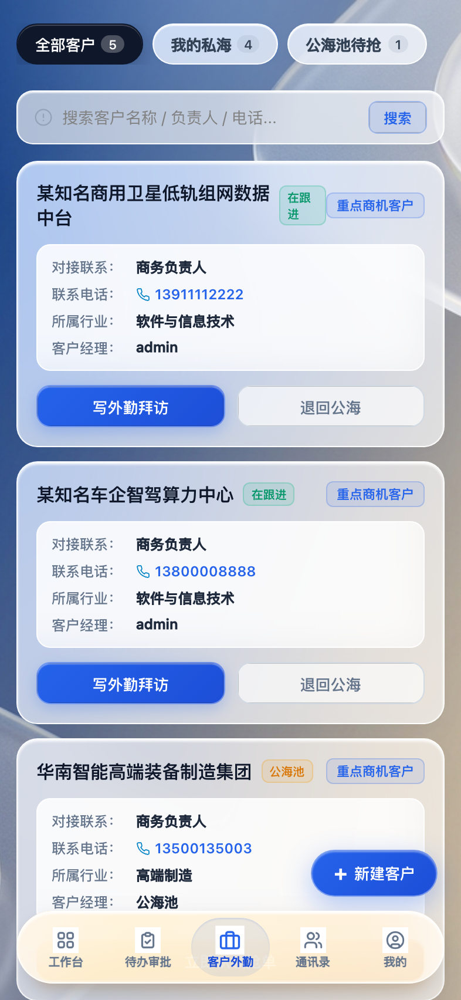

##### 4. 移动 ERP 云仓物料管理
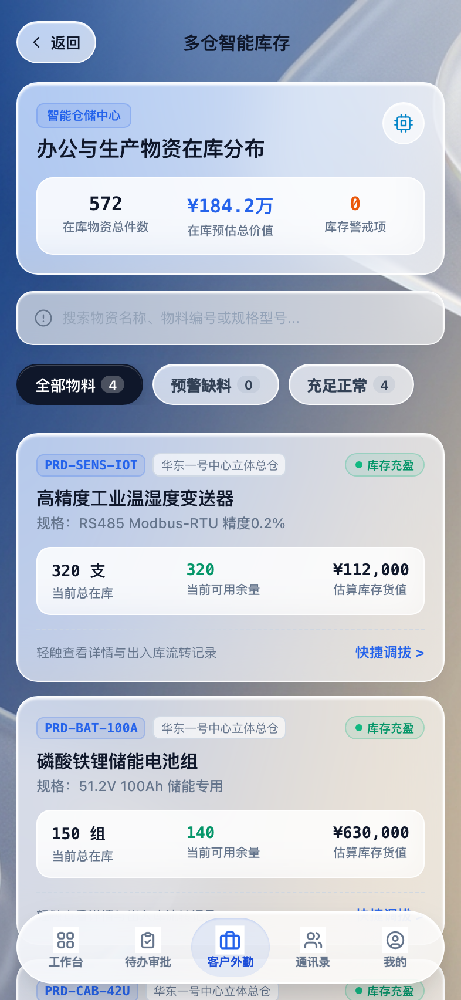

##### 5. 专属空间数据安全隔离中心
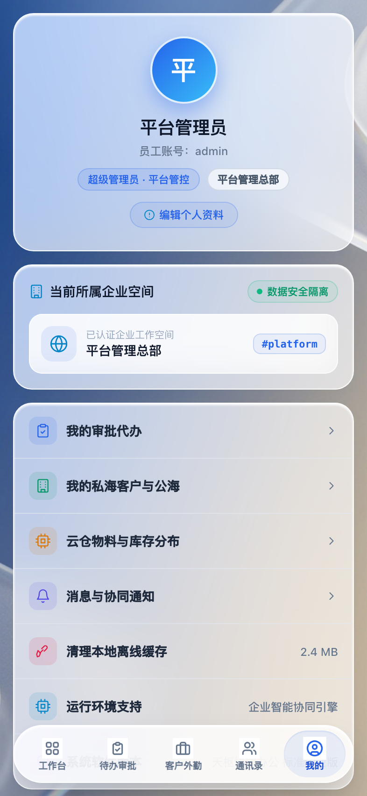

##### 6. 移动端专属租户空间直连登录
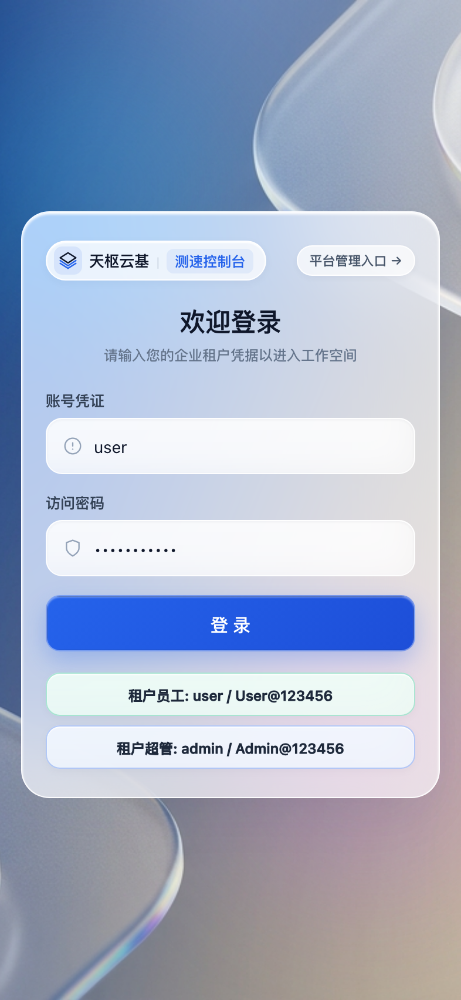

---

## 二、 多租户体系与生产路由架构 (Multi-Tenancy Routing)

### 2.1 租户数据隔离机制
天枢云基采用**字段级共享数据库隔离机制（Schema-Sharing with Tenant Column）**：
1. **数据表级隔离**：所有业务表（用户、部门、客户、流程单据、ERP 物料等）统一包含 `tenant_id` 或 `tenant_code` 字段。
2. **底层自动拦截**：通过 MyBatis-Plus `TenantLineInnerInterceptor`，在 ORM 层面自动在所有 `SELECT / INSERT / UPDATE / DELETE` 语句末尾拼装 `WHERE tenant_id = ?`，研发人员编写 SQL 时无需手工关心租户隔离，杜绝跨租户越权漏洞。
3. **平台管理特权与超管模式**：平台超管租户（ID 为 `1` 或编码 `platform`）拥有系统全量空间巡检与管控能力；租户用户（如 `tenant-ce`）登录后强绑定专属租户上下文。

### 2.2 生产级域名与 URL 路由方案

在生产部署中，平台支持两种业界主流的多租户接入规范：

#### 方案 A：子域名/泛域名解析（推荐，企业专属感最强）
* **平台超管总控台**：`https://admin.tianshu.cloud`
* **企业 A 独立门户**：`https://tenant-a.tianshu.cloud`
* **企业 B 独立门户**：`https://tenant-b.tianshu.cloud`
* **移动端统一入口**：`https://m.tianshu.cloud`

> **路由机理**：DNS 配置 `*.tianshu.cloud` CNAME 指向 Nginx 服务器 IP。Nginx 通过正则从 HTTP Host 头中提取子域名（如 `tenant-a`），自动通过反向代理添加 `proxy_set_header X-Tenant-Code $tenant_subdomain;` 请求头传递给后端 Spring Boot，前端无需任何参数拼接即可无感知识别企业空间。

#### 方案 B：统一主域名 + 路径路由模式（适合无泛域名证书的场景）
* **平台超管总控台**：`https://console.tianshu.cloud/login`
* **租户登录与门户**：`https://console.tianshu.cloud/tenant-a/login` 或 `https://console.tianshu.cloud/login?tenantCode=tenant-a`

---

## 三、 Docker Compose 一键生产编排部署 (Standard Docker Deployment)

生产环境推荐使用 Docker 与 Docker Compose 编排容器化集群，具备环境一致性、秒级弹性扩缩容、数据库与缓存高可用健康检查等优势。

### 3.1 生产编排文件 (`docker-compose.prod.yml`)

```yaml
version: '3.8'

services:
  # ==========================================
  # 1. MySQL 8.3 核心生产数据库
  # ==========================================
  saas-mysql:
    image: mysql:8.3.0
    container_name: saas-mysql
    restart: always
    command:
      - --character-set-server=utf8mb4
      - --collation-server=utf8mb4_unicode_ci
      - --default-time-zone=+08:00
      - --max_connections=1000
    environment:
      MYSQL_ROOT_PASSWORD: ${DB_ROOT_PASSWORD:-Tianshu@Prod2026!}
      MYSQL_DATABASE: saas_basics
      MYSQL_USER: saas_app
      MYSQL_PASSWORD: ${DB_PASSWORD:-SaaS@SecureApp2026!}
    ports:
      - "127.0.0.1:3306:3306" # 仅内网/本机监听，禁止公网裸露
    volumes:
      - saas-mysql-data:/var/lib/mysql
      - /etc/localtime:/etc/localtime:ro
    healthcheck:
      test: ["CMD", "mysqladmin", "ping", "-h", "127.0.0.1", "-uroot", "-p$${MYSQL_ROOT_PASSWORD}"]
      interval: 10s
      timeout: 5s
      retries: 10
      start_period: 30s
    networks:
      - saas-network

  # ==========================================
  # 2. Redis 7.2 生产缓存与会话中枢
  # ==========================================
  saas-redis:
    image: redis:7.2-alpine
    container_name: saas-redis
    restart: always
    command: ["redis-server", "--requirepass", "${REDIS_PASSWORD:-Redis@Tianshu2026!}", "--appendonly", "yes"]
    ports:
      - "127.0.0.1:6379:6379" # 仅内网/本机监听
    volumes:
      - saas-redis-data:/data
    healthcheck:
      test: ["CMD", "redis-cli", "-a", "${REDIS_PASSWORD:-Redis@Tianshu2026!}", "ping"]
      interval: 5s
      timeout: 3s
      retries: 10
    networks:
      - saas-network

  # ==========================================
  # 3. 后端核心微服务 (Spring Boot 3 + Flowable)
  # ==========================================
  saas-backend:
    build:
      context: ./server
      dockerfile: Dockerfile
    container_name: saas-backend
    restart: always
    depends_on:
      saas-mysql:
        condition: service_healthy
      saas-redis:
        condition: service_healthy
    environment:
      SPRING_PROFILES_ACTIVE: prod
      DB_HOST: saas-mysql
      DB_PORT: 3306
      DB_NAME: saas_basics
      DB_USERNAME: saas_app
      DB_PASSWORD: ${DB_PASSWORD:-SaaS@SecureApp2026!}
      REDIS_HOST: saas-redis
      REDIS_PORT: 6379
      REDIS_PASSWORD: ${REDIS_PASSWORD:-Redis@Tianshu2026!}
      JWT_SECRET: ${JWT_SECRET:-TianshuCloudSecretKeyForTokenSigning2026Minimum256BitsLong!}
      JAVA_OPTS: "-Xms1024m -Xmx2048m -XX:+UseG1GC -Dfile.encoding=UTF-8"
    ports:
      - "127.0.0.1:8080:8080"
    healthcheck:
      test: ["CMD", "wget", "--quiet", "--tries=1", "--spider", "http://127.0.0.1:8080/actuator/health"]
      interval: 20s
      timeout: 5s
      retries: 5
      start_period: 40s
    networks:
      - saas-network

  # ==========================================
  # 4. PC 前端静态服务与内置 Nginx
  # ==========================================
  saas-frontend:
    build:
      context: ./web
      dockerfile: Dockerfile
    container_name: saas-frontend
    restart: always
    depends_on:
      - saas-backend
    ports:
      - "80:80"
      - "443:443"
    volumes:
      - ./nginx/ssl:/etc/nginx/ssl:ro
      - ./nginx/nginx.prod.conf:/etc/nginx/conf.d/default.conf:ro
    networks:
      - saas-network

networks:
  saas-network:
    driver: bridge

volumes:
  saas-mysql-data:
    driver: local
  saas-redis-data:
    driver: local
```

### 3.2 环境变量配置文件 (`.env.production`)
在部署根目录下创建 `.env` 文件，避免明文硬编码：
```ini
# MySQL 数据库配置
DB_ROOT_PASSWORD=Tianshu@RootStrongPassword_2026!
DB_PASSWORD=Tianshu@AppSafePassword_2026!

# Redis 配置
REDIS_PASSWORD=Redis@TianshuCluster_2026!

# 安全 JWT 签名秘钥 (长度建议 >= 64 字符)
JWT_SECRET=c2Fhc19iYXNpY3NfZW50ZXJwcmlzZV9zZWNyZXRfa2V5XzIwMjZfcHJvZHVjdGlvbl9zZWN1cmVfc2lnbmluZw==

# 外部暴露端口定义
SAAS_FRONTEND_PORT=80
SAAS_BACKEND_PORT=8080
```

---

## 四、 生产级 Nginx 反向代理与泛域名 SSL 配置 (Gateway & Ingress)

在对外暴露的 Nginx 节点上配置泛域名 SSL 证书与多租户路由转发。

### 4.1 生产级完整 Nginx 配置 (`nginx.prod.conf`)

```nginx
# =======================================================
# 天枢云基生产级网关配置 (支持泛域名多租户与移动端分流)
# =======================================================

# 1. HTTP 强制跳转 HTTPS
server {
    listen 80;
    server_name tianshu.cloud *.tianshu.cloud;
    return 301 https://$host$request_uri;
}

# 2. 生产核心 HTTPS 虚拟主机 (通配符 SSL 证书)
server {
    listen 443 ssl http2;
    server_name ~^(?<subdomain>[a-zA-Z0-9-]+)\.tianshu\.cloud$;

    # SSL 证书配置 (由 Let's Encrypt 或 云服务商签发)
    ssl_certificate /etc/nginx/ssl/tianshu.cloud.crt;
    ssl_certificate_key /etc/nginx/ssl/tianshu.cloud.key;
    ssl_session_timeout 1d;
    ssl_session_cache shared:SSL:50m;
    ssl_session_tickets off;
    ssl_protocols TLSv1.2 TLSv1.3;
    ssl_ciphers ECDHE-ECDSA-AES128-GCM-SHA256:ECDHE-RSA-AES128-GCM-SHA256:ECDHE-ECDSA-AES256-GCM-SHA384:ECDHE-RSA-AES256-GCM-SHA384;
    ssl_prefer_server_ciphers on;

    # Gzip 静态资源极致压缩
    gzip on;
    gzip_min_length 1k;
    gzip_buffers 4 16k;
    gzip_http_version 1.1;
    gzip_comp_level 6;
    gzip_types text/plain application/javascript text/css application/xml text/javascript application/json image/svg+xml;
    gzip_vary on;

    # 客户端上传单文件最大限制
    client_max_body_size 500m;

    # ===================================================
    # 动静分流：PC 前端控制台静态文件 (Vue 3 SPA)
    # ===================================================
    location / {
        root /usr/share/nginx/html;
        index index.html;
        try_files $uri $uri/ /index.html;

        # 静态资源长期缓存与防重验证
        location ~* \.(js|css|png|jpg|jpeg|gif|ico|svg|woff2|woff|ttf)$ {
            expires 30d;
            add_header Cache-Control "public, no-transform";
        }
    }

    # ===================================================
    # 移动端 H5 独立路径分流 (/mobile/ 或 m.tianshu.cloud)
    # ===================================================
    location /mobile/ {
        alias /usr/share/nginx/mobile/;
        index index.html;
        try_files $uri $uri/ /mobile/index.html;
    }

    # ===================================================
    # 后端业务 API 反向代理 (携带提取的租户子域名)
    # ===================================================
    location /api/ {
        proxy_pass http://saas-backend:8080/api/;
        
        # 核心多租户子域名注入：若子域为 admin，则为 platform；否则注入子域名
        set $tenant_code $subdomain;
        if ($subdomain = "admin") {
            set $tenant_code "platform";
        }
        proxy_set_header X-Tenant-Code $tenant_code;

        # 标准代理头透传真实客户端 IP 与协议
        proxy_set_header Host $host;
        proxy_set_header X-Real-IP $remote_addr;
        proxy_set_header X-Forwarded-For $proxy_add_x_forwarded_for;
        proxy_set_header X-Forwarded-Proto $scheme;

        # 超时时间优化
        proxy_connect_timeout 60s;
        proxy_read_timeout 180s;
        proxy_send_timeout 180s;

        # WebSocket 长连接与双工支持
        proxy_http_version 1.1;
        proxy_set_header Upgrade $http_upgrade;
        proxy_set_header Connection "upgrade";
    }

    # 开放平台 Open API 路由
    location /open/api/ {
        proxy_pass http://saas-backend:8080/open/api/;
        proxy_set_header Host $host;
        proxy_set_header X-Real-IP $remote_addr;
        proxy_set_header X-Forwarded-For $proxy_add_x_forwarded_for;
        proxy_set_header X-Forwarded-Proto $scheme;
    }

    # 错误页友好响应
    error_page 500 502 503 504 /50x.html;
    location = /50x.html {
        root /usr/share/nginx/html;
    }
}
```

---

## 五、 数据库管理与 Flyway 自动化版本平滑升级 (Database Lifecycle)

天枢云基引入 **Flyway 10.x** 作为生产数据库迁移的唯一准绳，严禁运维工程师在生产数据库手工执行 DDL 语句。

### 5.1 数据库自动迁移规则
1. **命名规范**：`V{版本号}__{英文描述}.sql`，例如 `V57__flowable_bpmn_integration.sql`、`V62__app_devops_service_center.sql`。
2. **不可篡改性**：已发布的迁移脚本（V1 至 V62）在发布后其文件内容 Checksum 强校验，严禁修改历史脚本内容；新需求必须递增创建新脚本（如 `V63__xxx.sql`）。
3. **自动化执行**：后端 Spring Boot 服务容器启动时，Flyway 会自动扫描 `db/migration` 目录，获取当前数据库 `flyway_schema_history` 表执行最新增量脚本，执行成功后应用才对外开放健康检查探针。

### 5.2 历史核心版本线速查 (Baseline Highlights)
* **V1 ~ V6**：平台基础底座、组织架构、IAM 权限模型、认证鉴权。
* **V17**：多租户门户入口 (`sys_portal_entry`) 动态发现模型。
* **V21 ~ V34**：数据字典、按钮级权限矩阵、系统菜单树规范。
* **V35 ~ V39**：工作流审批基础骨架与权限绑定。
* **V43 ~ V47**：企业级增强租户隔离、逻辑删除唯一索引防冲突方案。
* **V48 ~ V50**：ERP 供应链进销存物料模型与 CRM 客户商机公海池。
* **V51 ~ V56**：SAML/OIDC 企业 SSO 联合认证与 Open API 开放平台。
* **V57**：Flowable BPMN 2.0 工业级流程引擎原生表集成。
* **V58 ~ V59**：统一支付收银中心与订单账单模型。
* **V60**：企业级开箱预置演示数据与安全策略初始基线。
* **V61**：ERP 进销存唯一索引加固与物料出入库逻辑删除冲突防护。
* **V62**：服务编排与发布中台数据表 (`app_managed_service`, `app_build_record`, `app_service_artifact`) 与系统运维菜单权限。

---

## 六、 移动端与小程序生产构建指引 (Mobile Multi-Platform Deployment)

移动端工程位于 `/mobile` 目录，采用 `uni-app` 跨端架构，一套源码构建为 **H5 企业移动工作台** 与 **微信小程序**。

### 6.1 编译与发布模式

#### 1. H5 移动工作台发行构建
```bash
cd mobile
npm install
npm run build:h5
```
* **输出目录**：`mobile/dist/build/h5`
* **部署方式**：将此目录内的所有文件复制至 Nginx Web 服务器的 `/usr/share/nginx/mobile` 目录下，并确保 Nginx 配置中的 `/mobile/` 路由段正确匹配并配置 `try_files $uri $uri/ /mobile/index.html;`。

#### 2. 微信小程序编译与审核发布
```bash
cd mobile
npm run build:mp-weixin
```
* **输出目录**：`mobile/dist/build/mp-weixin`
* **发布流程**：
  1. 打开 **微信开发者工具**，导入 `mobile/dist/build/mp-weixin` 目录；
  2. 填写企业注册的微信小程序 `AppID`；
  3. 在微信公众平台后台「开发」->「开发管理」->「服务器域名」中，将生产 API 域名加入白名单：
     - `request合法域名`：`https://api.tianshu.cloud`
     - `uploadFile合法域名`：`https://api.tianshu.cloud`
     - `downloadFile合法域名`：`https://api.tianshu.cloud`
  4. 点击开发者工具右上角「上传」版本，前往微信公众平台提交审核与全量发布。

---

## 七、 生产安全规范与高可用运维保障 (SecOps & Monitoring)

### 7.1 生产基线安全清单 (Security Hardening)
1. **数据库外网隔离**：MySQL (3306) 与 Redis (6379) 严禁映射到公网 IP，仅允许云主机内网 VPC 互通或 Docker 内部容器网段访问。
2. **密钥动态注入**：生产环境中的数据库密码、Redis 密码、JWT Secret 必须通过部署流水线环境变量（GitLab CI Variables / Jenkins Credentials / K8s Secret）动态下发，禁止提交至 Git 代码仓库。
3. **CORS 跨域白名单收敛**：后端生产 Profile 仅放行实际业务域名（`https://*.tianshu.cloud` 与小程序安全域），严禁在生产开启 `allowedOrigins("*")`。

### 7.2 健康检查与日常巡检
* **后端健康状态探测**：`GET http://localhost:8080/actuator/health`
* **Nginx 网关探活**：`GET http://localhost/healthz`
* **日常备份策略**：
  - **MySQL 备份**：建议设置每日凌晨 2:00 进行全量冷备份，并开启 binlog 增量保存至少 30 天。
    ```bash
    # 示例自动备份脚本
    mysqldump -u saas_app -p saas_basics --single-transaction --quick --default-character-set=utf8mb4 | gzip > /data/backup/mysql/saas_basics_$(date +%Y%m%d_%H%M%S).sql.gz
    ```
  - **MinIO 对象存储**：建议配置跨区域副本同步或异地对象备份。

---

## 八、 服务编排与发布中台实战 (DevOps Service Center & CI/CD)

天枢云基原生内置研发运维一体化的【服务编排与发布中台】（PC 控制台「系统中心」->「服务编排与发布中台」），实现多应用、微服务与跨端容器的一站式可视化运维管控。

### 8.1 核心运维能力
1. **多微服务全生命周期纳管**：
   * 原生预置 `backend-main` (端口 8080)、`workflow-app` (端口 8085)、`web-console` (端口 9527)、`mobile-h5` (端口 5173)；
   * 支持通过主机进程树（ProcessTree）与 Docker 容器双模驱动；
   * 状态流转具备 `STARTING` 与 `STOPPING` 防抖过渡状态，精准探活端口释放与进程消亡，彻底杜绝虚假成功提示。
2. **免外置 Jenkins 的本地 CI 构建流水线**：
   * 支持 Maven、npm、Docker 等一键触发源码重编译；
   * 实时输出构建控制台标准/错误流日志，计算构建耗时与制品 MD5 指纹；
   * 产物自动归档入库，支持历史版本秒级平滑回滚。
3. **实时 SSE 流式日志控制台**：
   * 采用 Server-Sent Events 流式传输标准日志，集成心跳保活帧（15s）；
   * 仿 macOS 拟态深色终端，内置智能自动滚屏吸底、用户回溯暂停、悬浮一键回底、关键字正则过滤与全量日志导出。

---

## 九、 13 卷专栏实战手册速查 (Yuque Knowledge Base Index)

天枢云基已完成全套生产指南的模块化拆分，各专栏手册均可一键导入语雀（Yuque）等知识库系统中独立共享与学习：

| 专栏序号与手册名称 | 对应文档路径 | 核心内容提要 |
| :--- | :--- | :--- |
| **01. 平台定位与系统架构全景** | [`docs/manuals/01_平台定位与系统架构全景.md`](./manuals/01_平台定位与系统架构全景.md) | 集团控股与 SaaS 平台定位、分层全景架构拓扑与核心特性 |
| **02. 核心生产端实机视觉呈现** | [`docs/manuals/02_核心生产端实机视觉呈现_UI_Showcase.md`](./manuals/02_核心生产端实机视觉呈现_UI_Showcase.md) | PC 流光毛玻璃驾驶舱与移动端悬浮灵动岛实机高清图解 |
| **03. Docker Compose 一键生产编排部署** | [`docs/manuals/03_Docker_Compose_一键生产编排部署.md`](./manuals/03_Docker_Compose_一键生产编排部署.md) | 包含生产 compose 文件详解、健康检查、日志轮转与备份 |
| **04. 生产级 Nginx 泛域名网关与 SSL 配置** | [`docs/manuals/04_生产级_Nginx_泛域名网关与_SSL_配置.md`](./manuals/04_生产级_Nginx_泛域名网关与_SSL_配置.md) | 泛域名 SSL 通配符终结、子域名提取注入 `X-Tenant-Code`、跨域防刷 |
| **05. 数据库生命周期与 Flyway 自动化迁移** | [`docs/manuals/05_数据库生命周期与_Flyway_自动化迁移.md`](./manuals/05_数据库生命周期与_Flyway_自动化迁移.md) | Flyway 10.x 迁移准绳、V1~V62 全量核心版本线与防篡改策略 |
| **06. 跨端工作台生产构建 (PC/H5/小程序)** | [`docs/manuals/06_跨端工作台生产构建_PC_H5_微信小程序.md`](./manuals/06_跨端工作台生产构建_PC_H5_微信小程序.md) | Vue 3 PC 控制台与 uni-app 跨端工作台全平台打包与发布规范 |
| **07. 生产安全基线 SecOps 与高可用运维保障**| [`docs/manuals/07_生产安全基线_SecOps_与高可用运维保障.md`](./manuals/07_生产安全基线_SecOps_与高可用运维保障.md) | 凭证隔离、网络安全域、数据库冷备份脚本与异常应急预案 |
| **08. 组织架构与企业级 IAM 权限配置指南** | [`docs/manuals/08_组织架构与企业级_IAM_权限配置指南.md`](./manuals/08_组织架构与企业级_IAM_权限配置指南.md) | 集团-企业-部门-岗位-员工五级实体架构，菜单/按钮/行级数据范围 |
| **09. Flowable BPMN 2.0 工业级工作流实战** | [`docs/manuals/09_Flowable_BPMN_2_0_工业级工作流实战.md`](./manuals/09_Flowable_BPMN_2_0_工业级工作流实战.md) | Flowable 7.x 审批流、串并行会签、驳回加签与移动端快捷签批 |
| **10. CRM 客户全生命周期与商机管理实战** | [`docs/manuals/10_CRM_客户全生命周期与商机管理实战.md`](./manuals/10_CRM_客户全生命周期与商机管理实战.md) | 线索跟进、商机阶段漏斗、客户公海池流转与合同回款流水管理 |
| **11. ERP 进销存与云仓物料管理实战** | [`docs/manuals/11_ERP_进销存与云仓物料管理实战.md`](./manuals/11_ERP_进销存与云仓物料管理实战.md) | 物料多规格档案、采购订单、出入库流水核算与高低库存预警 |
| **12. 开放平台 Open API 与企业 SSO 对接指南** | [`docs/manuals/12_开放平台_Open_API_与企业_SSO_对接指南.md`](./manuals/12_开放平台_Open_API_与企业_SSO_对接指南.md) | Open API 签名网关、AppKey/HMAC 鉴权与 SAML/OIDC/企微免登 |
| **13. 服务编排与发布中台 DevOps 运维实战** | [`docs/manuals/13_服务编排与发布中台_DevOps_CI_CD_运维实战.md`](./manuals/13_服务编排与发布中台_DevOps_CI_CD_运维实战.md) | 双驱动编排引擎、本地 CI 构建流水线、制品秒级回滚与 SSE 流式终端 |

---
*本文档由天枢云基研发团队与系统架构委员会联合编制，持续跟踪生产演进。*
