# 02. 核心生产端实机视觉呈现 (UI Showcase)

> **所属专栏**：天枢云基 PaaS 企业级数字化底座 · 第一卷  
> **文档版本**：v1.0.0 (Release)  
> **阅读对象**：UI/UX 设计师、产品经理、前端工程师、技术选型决策者  

---

## 1. 设计语言与美学哲学

天枢云基在前端视觉设计上摒弃了传统后台千篇一律的沉闷扁平风格，率先将 **Apple visionOS 与 iOS 27 Fluid Glass（流光毛玻璃）** 设计语言深度融入中后台管理系统与跨端移动工作台：

* **自适应环境流光毛玻璃 (Real-Time Backdrop Blur)**：采用高饱和度流体光斑背景配合 `backdrop-filter: blur(28px) saturate(180%)`，使面板悬浮于界面之上，呈现通透灵动的层级纵深感；
* **微渐变柔光边框 (Subtle Inner Stroke)**：配合 `1px solid rgba(255, 255, 255, 0.45)` 的高光描边，确保在亮色模式下清爽通透，在暗色模式下深邃纯粹；
* **悬浮灵动岛交互 (Dynamic Island TabBar)**：移动端采用悬浮于屏幕底部的药丸型毛玻璃导航中枢，集成实时待办计数、状态微动效与触觉反馈。

---

## 2. PC 控制台视觉体验 (iOS 27 / visionOS 流光毛玻璃)

### 2.1 企业数据大屏与中枢驾驶舱

* **核心亮点**：聚合企业全局活跃租户数、API 吞吐量、近 30 日经营走势、系统健康雷达图与告警动态流。

### 2.2 Flowable BPMN 2.0 工业级流程审批中心
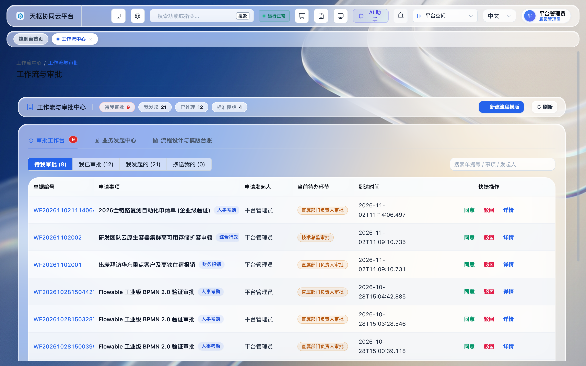
* **核心亮点**：支持待办任务审批、已办追踪、我的发起、可视化流程拓扑渲染以及审批意见流转轨迹。

### 2.3 ERP 进销存与物料仓储中枢
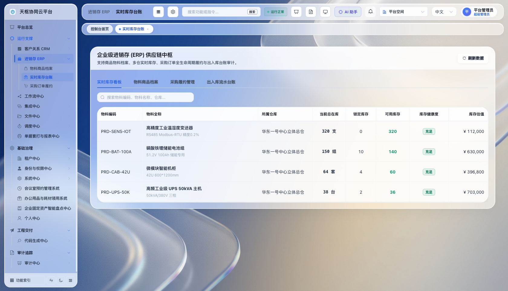
* **核心亮点**：多仓库物料台账实时盘点、批次追踪、入库核销、安全库存告警与出入库明细流水导出。

### 2.4 CRM 客户全生命周期与商机漏斗
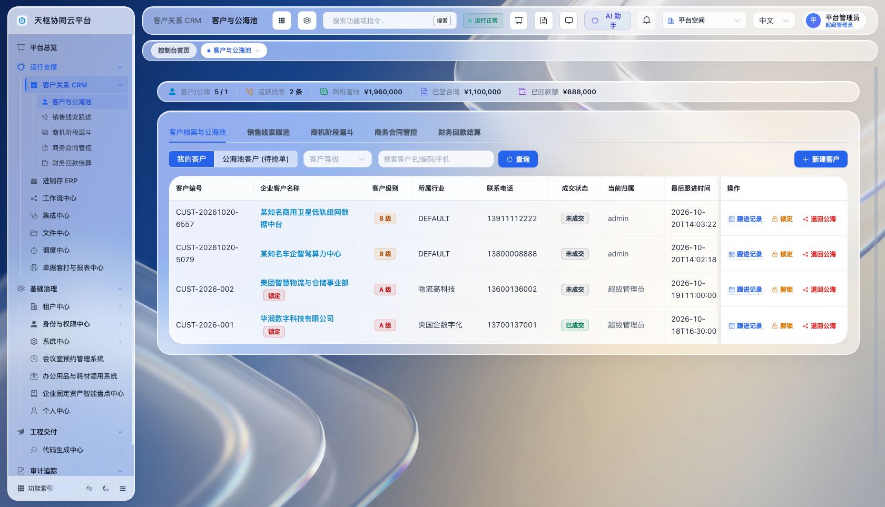
* **核心亮点**：客户公海池快速认领、商机阶段推进卡片（意向-方案-谈判-合同）、销售业绩看板与跟进日志。

### 2.5 权限矩阵与 IAM 细粒度管控
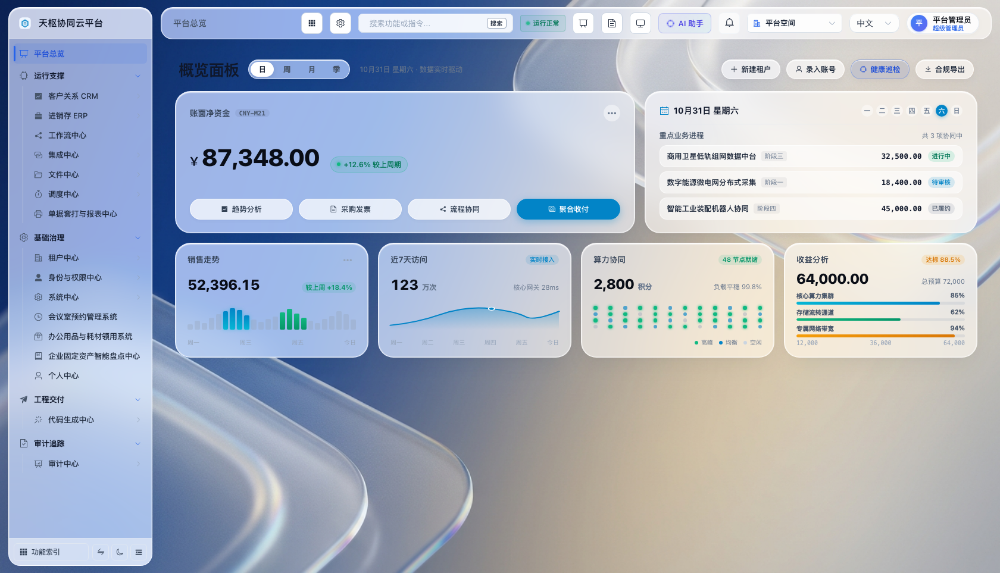
* **核心亮点**：功能菜单权限树、按钮级操作指令授权与行级数据范围（DataScope）可视化配置矩阵。

### 2.6 多租户动态 URL 空间隔离认证
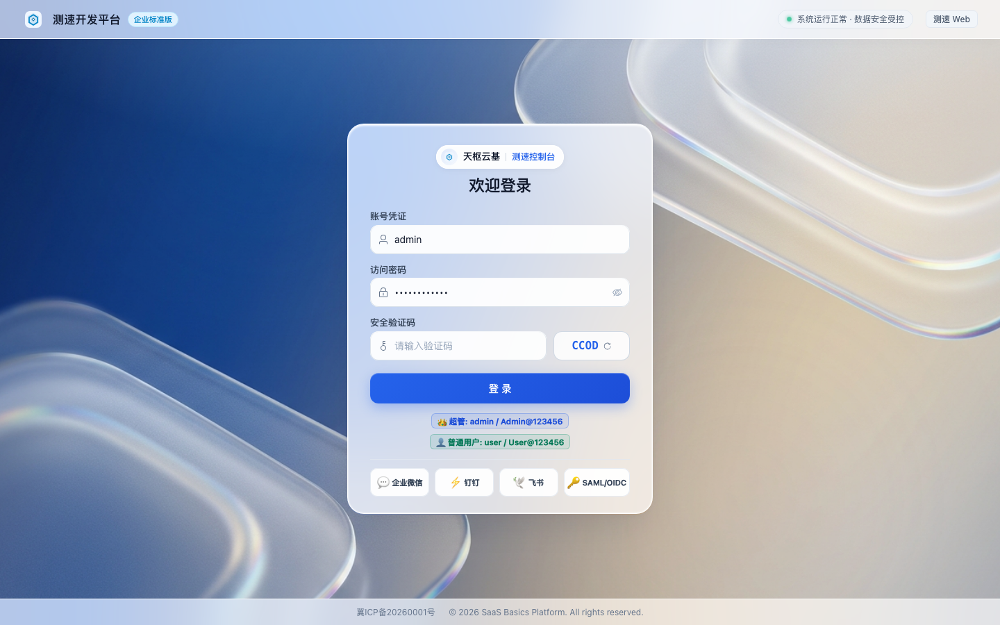
* **核心亮点**：基于子域名/企业代码的专属登录界面，自动加载企业自定义 Logo、品牌主色调与免密扫码。

### 2.7 服务编排与发布中台 (DevOps Console)
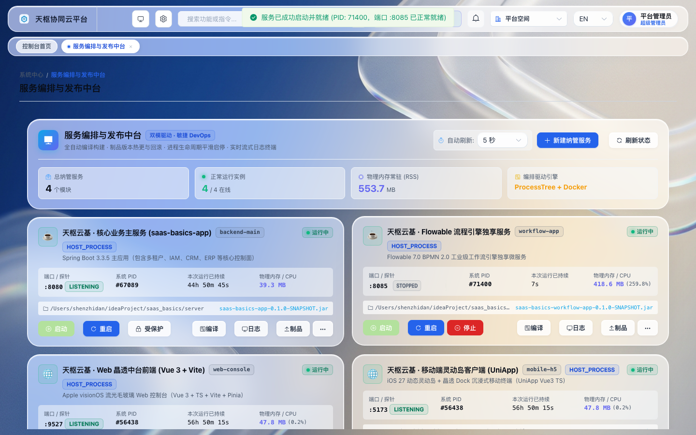
* **核心亮点**：微服务全生命周期可视化纳管、零抖动发丝进度条、免 Jenkins 本地 CI 构建、历史版本秒级回退与 SSE 仿 macOS 拟态深色终端。

---

## 3. 跨端移动工作台视觉体验 (uni-app 悬浮灵动岛 TabBar)

### 3.1 移动工作台与灵动岛导航
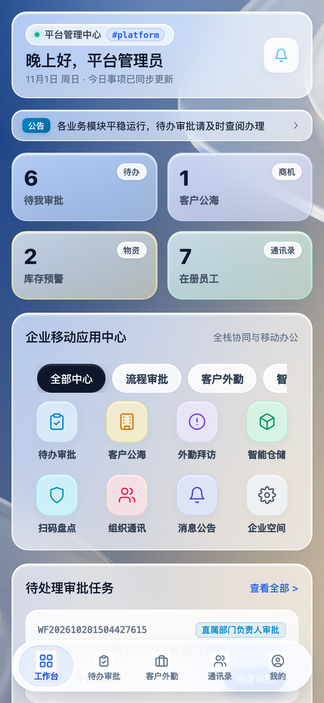
* **核心亮点**：悬浮式毛玻璃灵动岛导航栏，一键直达常用应用、快捷扫码与即时通知。

### 3.2 Flowable 移动审批待办
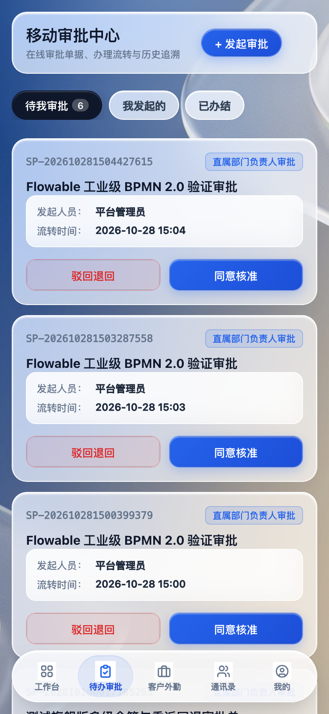
* **核心亮点**：碎片化时间快速处理请假、采购、合同付款等审批，支持一键同意、驳回与手写电子签名。

### 3.3 移动 CRM 客户公海池
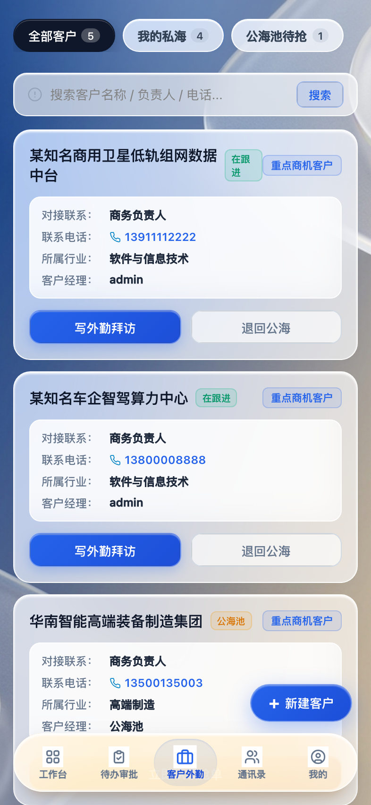
* **核心亮点**：销售外勤拜访定位签到、快速捞取公海客户、记录拜访沟通纪要与快捷电话呼叫。

### 3.4 移动 ERP 云仓物料管理
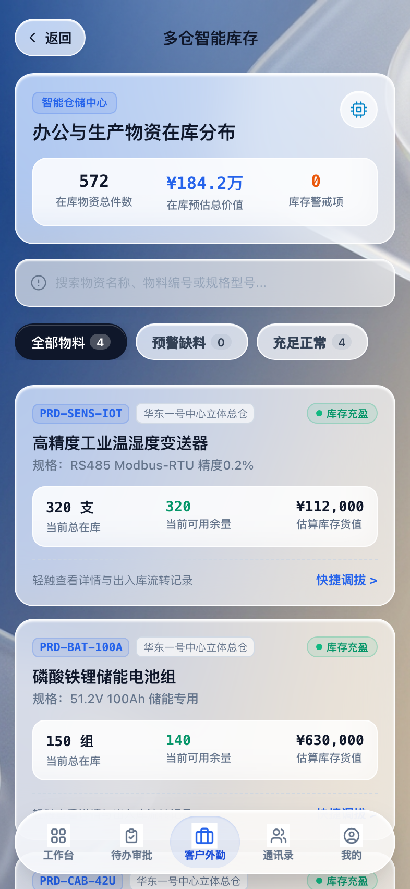
* **核心亮点**：仓管员手持扫码出入库、库位调拨查询、物料实时库存核对与低库存红色预警。

### 3.5 专属空间数据安全隔离中心
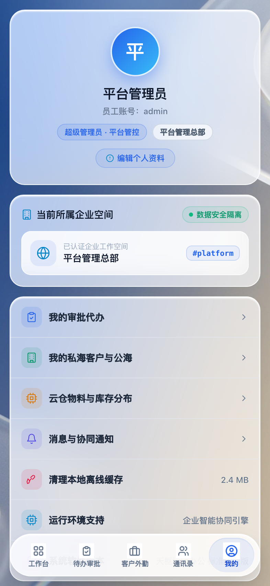
* **核心亮点**：展示当前绑定的企业租户空间、账号安全等级、安全审计日志与工作台主题切换。

### 3.6 移动端专属租户空间直连登录
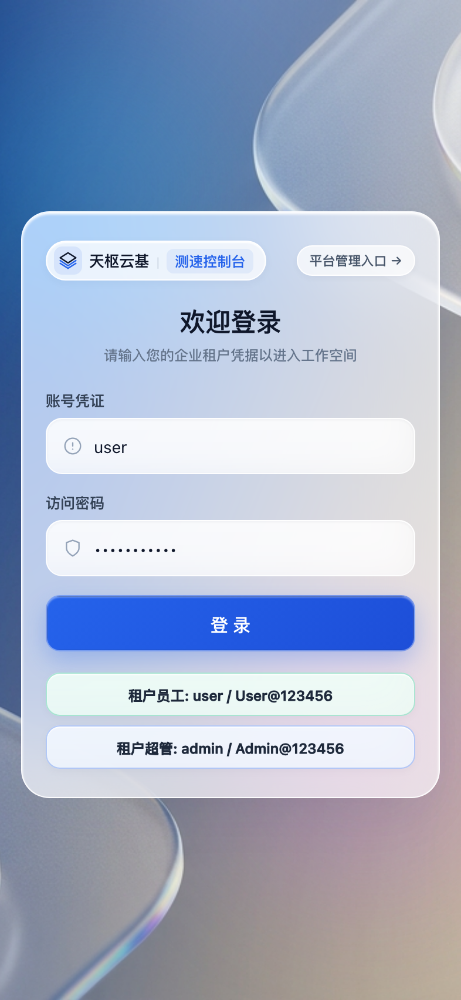
* **核心亮点**：支持企业租户代码快速切换，自动校验租户有效性与单点登录授权。
